# GTSRB Traffic-Sign Recognition for ADAS

## The problem

An advanced driver-assistance system (ADAS) must turn a traffic sign into a
correct driving instruction quickly enough to be useful and reliably enough to
be trusted. This project studies the recognition part of that problem:
classifying a cropped photograph of a German traffic sign into one of the 43
classes in the [German Traffic Sign Recognition Benchmark
(GTSRB)](https://benchmark.ini.rub.de/gtsrb_dataset.html).

GTSRB contains real road images with variation in scale, lighting, motion blur,
viewpoint, and occlusion. The classes include speed limits, priority rules,
warnings, prohibitions, and mandatory directions. English class names use the
widely adopted [GTSRB `signnames.csv`
mapping](https://github.com/udacity/CarND-Traffic-Sign-Classifier-Project/blob/master/signnames.csv).

This is a **recognition** project: every input is already cropped around a sign.
A deployable ADAS product would first need a detector to find signs in a full
camera frame.

## Business logic and success criteria

The cost of an error is not uniform. Misreading a speed limit, Stop, Yield, or
No-entry sign can directly affect vehicle behavior. Therefore, overall accuracy
is useful but is not sufficient for model selection.

The ADAS-critical set used here is:

- Classes **0–8**: the speed-limit family
- Class **13**: Yield
- Class **14**: Stop
- Class **17**: No entry

The primary and supporting key performance indicators (KPIs) are:

### Minimum critical recall — primary KPI

Recall for a class is:

> correctly recognized examples of the class / all true examples of the class

**Minimum critical recall** is the lowest recall among the 12 critical classes.
It exposes the weakest safety-relevant class instead of allowing strong,
frequent classes to hide it. Models were ranked first by this metric.

### Mean critical recall

The average recall across the same critical classes. This summarizes typical
safety-critical performance while the minimum reports the worst case.

### Macro precision and macro recall

**Precision** for a class is correctly predicted examples of the class / all
predictions of that class. **Recall** is correctly recognized examples / all
true examples. **Macro precision** and **macro recall** average those rates
equally across all 43 classes (same equal-weight idea as macro-F1).

They separate two error modes that F1 blends together: false alarms
(precision) versus misses (recall). For ADAS ranking we still prioritize
minimum critical recall; macro precision/recall are supporting diagnostics.

### Macro-F1

F1 is the harmonic mean of precision and recall. **Macro-F1** computes F1
independently for every class and averages the 43 values equally. It is useful
because GTSRB is imbalanced: frequent classes should not dominate the score.

### Average precision — threshold-free

Every metric above is measured at one operating point, the argmax of the
softmax. **Average precision** instead summarizes the whole precision-recall
curve produced by sweeping the decision threshold, so it measures how well the
model *ranks* candidates independently of where the cut is placed. It answers a
different question than macro-F1: whether a better operating point exists at
all.

### Accuracy

The fraction of all images classified correctly. It is the standard published
GTSRB metric and supports comparison with the literature, but it is secondary
to critical-class recall for this ADAS framing.

### Inference latency

End-to-end milliseconds per frame, including image loading, resizing,
preprocessing, and prediction at batch size one. Frames per second (FPS) is
reported as `1000 / ms per frame`. Latency determines whether the classifier can
fit within the larger detector–tracker–classifier ADAS pipeline.

## Data and evaluation protocol

`torchvision.datasets.GTSRB` provides 26,640 fixed training images and 12,630
official test images.

The development split was created from the training data:

- 80% of physical sign **tracks** for training
- 20% of tracks for validation
- Stratified independently within every class
- All frames from one physical sign remain on the same side of the split

This produced **21,360 training** and **5,280 validation** images. A random
image-level split would leak near-duplicate video frames and produce overly
optimistic validation results.

All model and architecture decisions were made from the validation set. The
official test set section below reports only the selected simple CNN.

## The modeling journey

The experiments deliberately began with simple baselines and added visual
structure step by step.

### 1. Flattened pixels

Images were resized to 32×32, flattened into 3,072 RGB values, standardized,
and classified with logistic regression or a linear SVM. These models were
fast, but a linear model over raw pixels cannot robustly handle translation,
blur, viewpoint, or local digit structure.

### 2. HOG and color

Histogram of Oriented Gradients (HOG) describes local edge directions, while an
HSV histogram adds sign-color information. The default 32×32 HOG+color linear
models raised validation accuracy from about 64% to 89%. A later grid search
in `gtsrb_baseline.ipynb` (saved as `artifacts/hog_hyperparam_sweep.csv`)
pushed the same family to **91.3%** accuracy by switching to 48×48 crops,
finer color histograms, and weaker SGD regularization. Digit-level speed-limit
confusion remains the ceiling.

### 3. Hierarchical and specialist models

A six-family router sent samples to group-specific classifiers. Higher
resolution and CNN specialists improved speed and danger signs, but the pipeline
became more complex and still underperformed a single end-to-end CNN.

### 4. ImageNet ResNet18 with a frozen backbone

ResNet18 was used as a fixed ImageNet feature extractor and only its final
fully connected layer was trained. This transfer-learning model improved only
modestly over raw pixels. ImageNet features represent general objects well but
do not naturally separate tiny traffic-sign digits.

### 5. Selected model: a simple 43-way CNN

The winning model learns directly from 48×48 RGB crops:

1. Three convolutional blocks, each with two 3×3 convolutions,
   batch normalization, ReLU, and max pooling
2. A 256-unit fully connected layer with dropout
3. A 43-class output layer

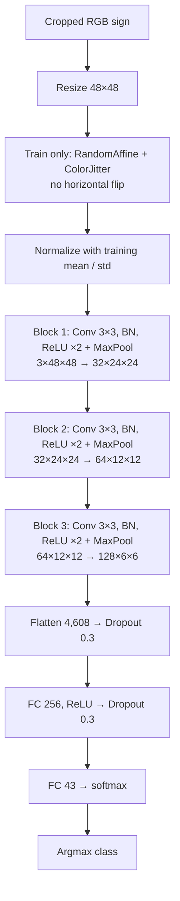

At inference the affine and color jitter steps are skipped; only resize and
normalize run before the network. Training used balanced sampling, AdamW, a
cosine learning-rate schedule, modest affine and color augmentation, and no
horizontal flips. Horizontal flips would change the meaning of directional
signs and digits.

### Feature dimensions by model

| Model family | Input representation | Feature dimensions used by classifier |
|---|---|---:|
| Flattened pixels (LR / linear SVM) | 32×32 RGB flattened | 3,072 |
| HOG + color (LR / linear SVM) | HOG(32×32 gray) + HSV histograms | 1,812 |
| Hierarchical linear (router + specialists) | Same HOG + color vector as above | 1,812 |
| Speed specialist HOG@48 (used in hybrid variants) | HOG(48×48 gray) + HSV histograms | 4,404 |
| Tuned HOG@48 + linear SVM | HOG(48×48 gray) + 24-bin HSV histograms | 4,428 |
| Simple 43-way CNN | Raw 48×48 RGB | learned 4,608-d embedding before FC head |
| Frozen ResNet18 + FC | Raw 224×224 RGB | learned 512-d backbone embedding to FC |

### Training behavior and the overfitting check

Accuracy on a held-out split is not enough to show that a network generalizes,
so the loss itself is tracked every epoch:

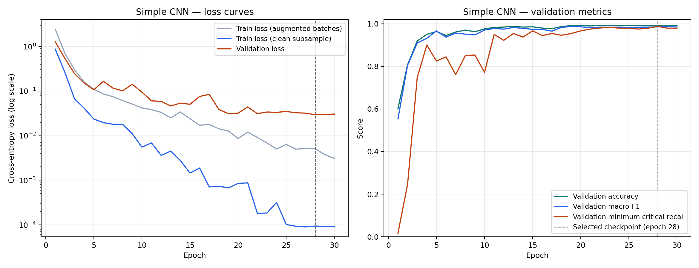

Three losses are recorded because they answer different questions. The gray
curve is the running cross-entropy over augmented training batches, which is
inflated by dropout and augmentation and therefore cannot be compared directly
with a clean validation loss. The blue curve re-evaluates the model in eval
mode on a fixed, un-augmented sample of 5,280 training images — the same size
as the validation set — so the blue-to-orange gap is a fair overfitting
diagnostic.

The result is a network that fits the training data essentially perfectly
(clean training loss 0.0001) while validation loss falls to **0.0296** and then
stays flat through the end of training. The signature of overfitting is a
validation loss that bottoms out and then climbs while training loss keeps
falling; that never happens here. The minimum validation loss occurs at epoch
28, which is also the epoch selected by the ADAS criterion, so the deployed
checkpoint is not taken from a degraded late-training regime.

The large *ratio* between training and validation loss is expected: the network
has enough capacity to memorize 21,360 images, and augmentation, dropout (0.3),
and weight decay keep that memorization from costing generalization. The 30
epochs completed in about 12 minutes on the M1 Pro.

## Validation results

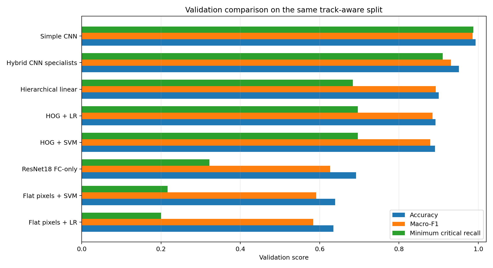

| Model | Accuracy | Macro-F1 | Minimum critical recall |
|---|---:|---:|---:|
| Flattened pixels + logistic regression | 63.45% | 58.37% | 20.00% |
| Flattened pixels + linear SVM | 63.88% | 59.10% | 21.67% |
| Frozen ImageNet ResNet18 + FC | 69.19% | 62.66% | 32.22% |
| HOG + linear SVM | 89.07% | 87.88% | 69.58% |
| HOG + logistic regression | 89.22% | 88.44% | 69.58% |
| Hierarchical linear model | 90.00% | 89.27% | 68.33% |
| Tuned HOG@48 + linear SVM | 91.34% | 91.19% | 78.89% |
| Hybrid Speed/Danger CNN specialists | 95.11% | 93.09% | 91.00% |
| **Simple 43-way CNN** | **99.28%** | **98.54%** | **98.75%** |

Macro precision and macro recall for the models re-evaluated from cached
features or the saved CNN checkpoint (hierarchical / hybrid / ResNet transfer
are omitted here because their saved predictions were not retained):

| Model | Macro precision | Macro recall |
|---|---:|---:|
| Flattened pixels + logistic regression | 61.59% | 63.69% |
| Flattened pixels + linear SVM | 62.81% | 63.57% |
| HOG + linear SVM | 90.65% | 82.66% |
| HOG + logistic regression | 90.23% | 81.26% |
| **Simple 43-way CNN** | **98.63%** | **98.64%** |

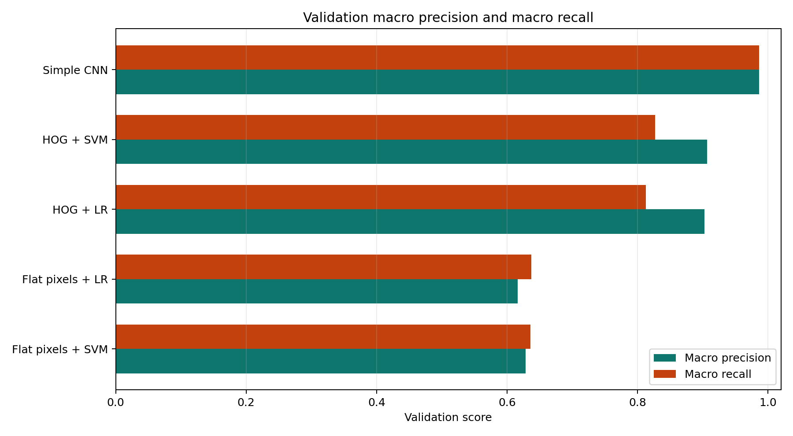

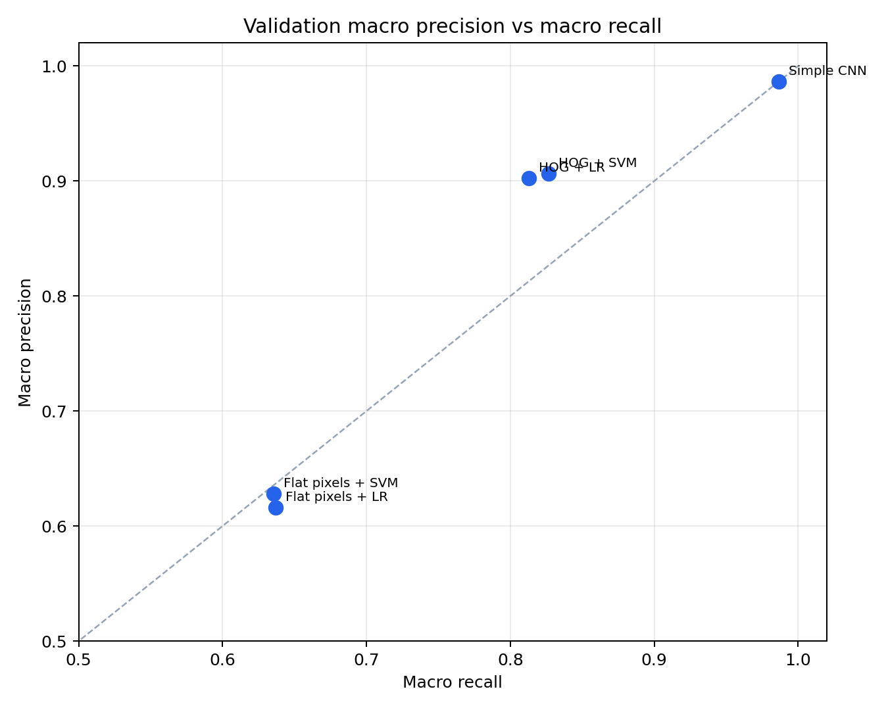

The progression is consistent: raw pixels establish a weak floor, HOG adds
useful spatial structure, 48×48 HOG tuning lifts the classical ceiling (minimum
critical recall 69.6% → 78.9%), specialists then improve difficult families,
and the end-to-end CNN learns the strongest shared representation without
routing errors. Across these models, macro precision and macro recall rise
together — the CNN does not buy recall by flooding false alarms. The tuned HOG
row is omitted from the two figures above because those plots were generated
before the sweep.

## Official test results — selected simple CNN only

The selected CNN was evaluated on all **12,630 official test images**.

| KPI | Official test result |
|---|---:|
| Accuracy | **98.87%** |
| Macro precision | **98.42%** |
| Macro recall | **98.48%** |
| Macro-F1 | **98.39%** |
| Minimum critical recall | **97.73%** |
| Mean critical recall | **99.42%** |
| Mean speed-family recall | **99.23%** |
| Stop recall | **100.00%** |
| Yield recall | **100.00%** |
| No-entry recall | **100.00%** |

The weakest critical class was **class 2, Speed limit (50 km/h)**, with 97.73%
recall. The three especially consequential priority/prohibition signs — Stop,
Yield, and No entry — were all recognized with 100% recall on this test set.

### Precision-recall curves

The table above reports a single operating point: the argmax of the softmax.
The curves below sweep the decision threshold across its whole range, so the
full precision-recall trade-off is visible rather than one point on it. Each
class is scored one-vs-rest, and average precision (AP) is the area under its
curve.

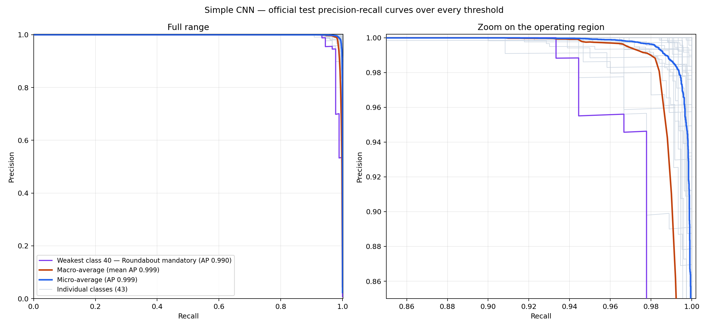

The full-range panel is nearly a right angle, which is what a strong classifier
looks like; the zoom panel is where the differences live. Micro-average AP is
**0.999** and mean per-class AP is **0.999**. The weakest class by AP is
**class 40, Roundabout mandatory (AP 0.990)** — the only class whose curve
visibly separates from the pack.

### Macro-F1 and macro precision/recall at every threshold

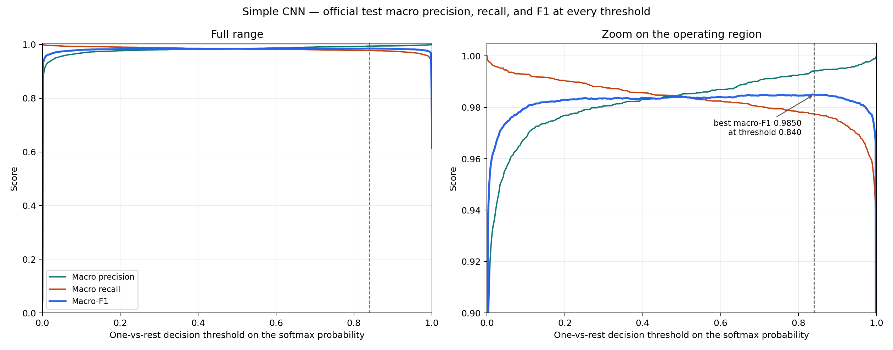

Sweeping the same one-vs-rest threshold shows the expected exchange: raising it
buys macro precision and spends macro recall. The two curves cross at 0.48, and
macro-F1 peaks at **0.9850 at threshold 0.84**, against **0.9839** for the
plain argmax decision. Tuning the threshold is therefore worth about one tenth
of a point of macro-F1, and macro-F1 stays within 0.002 of its peak everywhere
between 0.20 and 0.93. That flatness is itself the useful result: the model's
ranking is good enough that the operating point can be chosen on safety grounds
instead of being dictated by the metric.

Note that this threshold was read off the test set, so 0.9850 is an optimistic
upper bound rather than a number that could be claimed for deployment. A
production system would select the threshold on validation data.

### Confidence thresholds and abstention

An ADAS classifier can also decline a frame instead of guessing. Here the
argmax class is emitted only when its confidence clears a threshold; an
abstention is never a false positive but still counts as a miss.

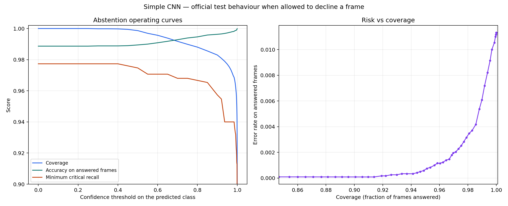

| Confidence threshold | Coverage | Accuracy on answered frames | Minimum critical recall |
|---|---:|---:|---:|
| 0.00 (always answer) | 100.00% | 98.87% | 97.73% |
| 0.90 | 98.30% | 99.63% | 95.73% |
| 0.99 | 96.47% | 99.86% | 93.33% |
| 0.999 | 94.13% | 99.97% | 90.80% |

Declining the least confident 1.7% of frames cuts the error rate on the
remaining frames from 1.13% to 0.37%. The cost is visible in the last column:
abstentions are counted as misses, so minimum critical recall falls. For a
single still image that is a poor trade, but in a real ADAS pipeline the
declined frames are the ones a tracker would resolve using neighboring frames,
which is why item 3 in Future work matters.

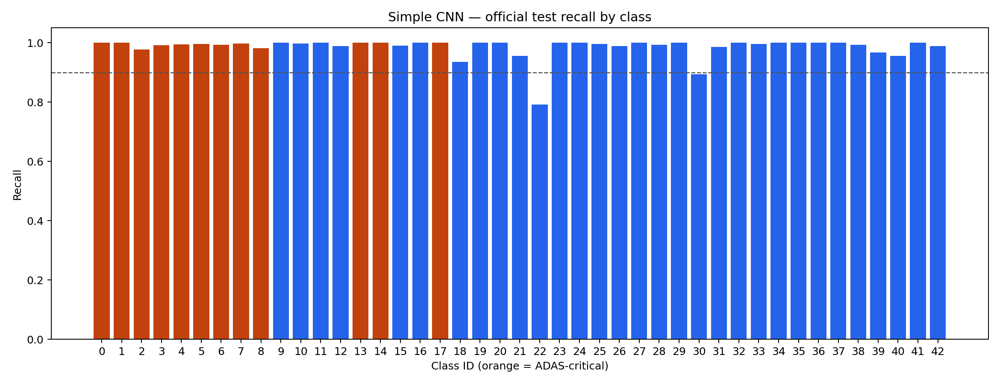

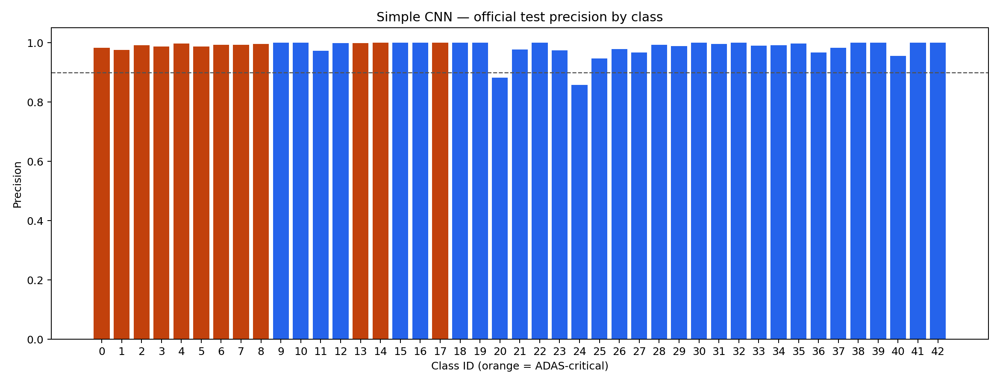

The lowest non-critical recall was **Bumpy road (class 22)** at 79.17%,
followed by Beware of ice/snow (89.33%) and General caution (93.59%). Those
warning triangles are the clearest targets for future augmentation and error
analysis. On the precision side the weakest classes are Road narrows right
(85.71%) and Dangerous curve right (88.24%) — both recall every one of their
own examples and pick up a few extra frames from neighboring triangle classes.

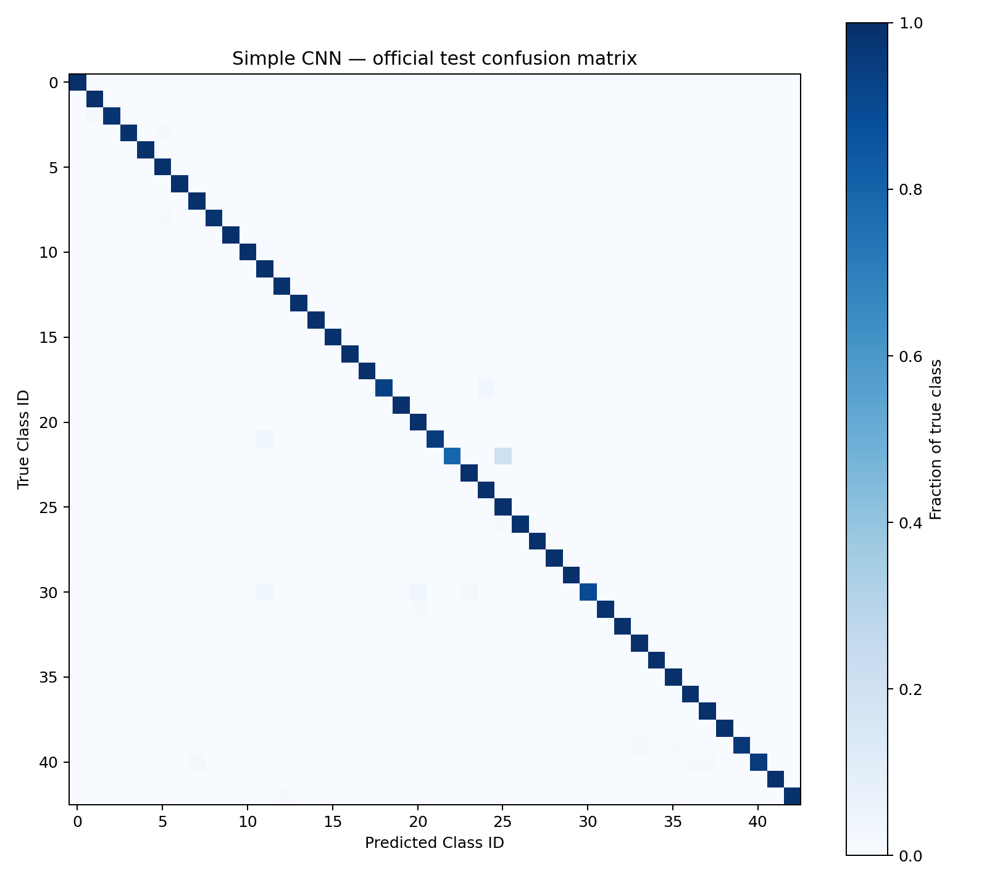

Speed signs were the main source of errors for classical models because they
share the same color and circular shape and differ mainly by small digits. The
CNN substantially resolved those confusions:

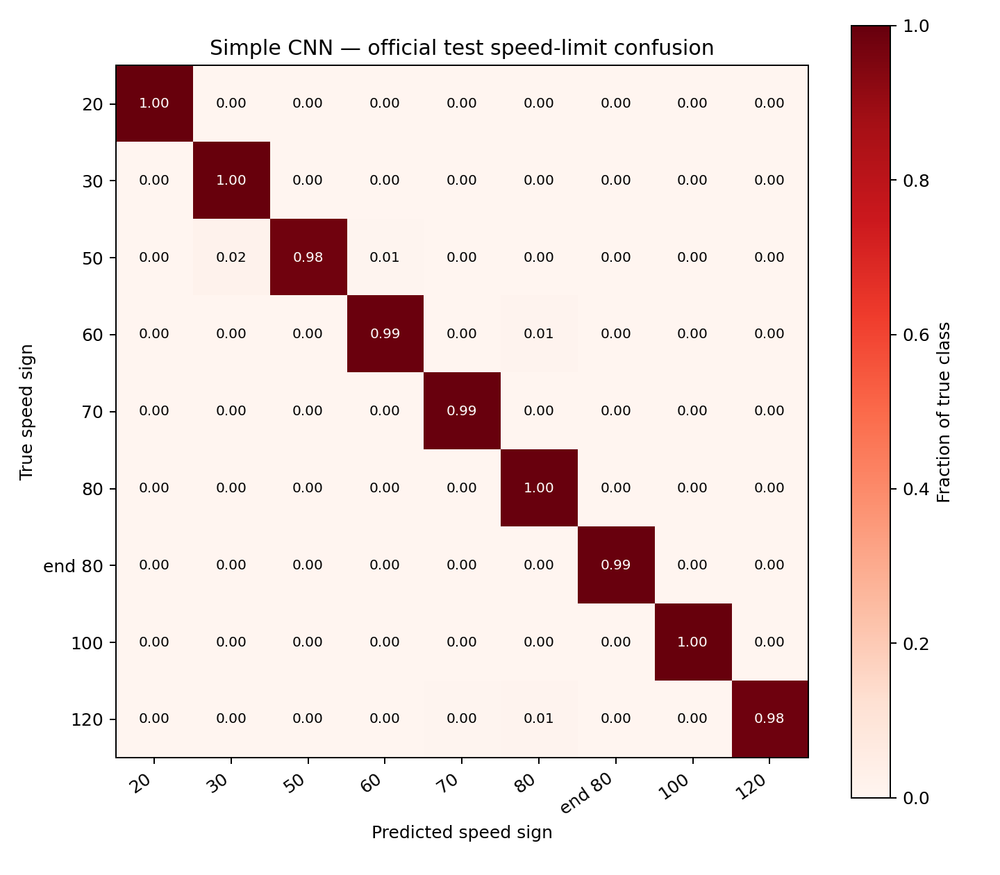

## Inference time

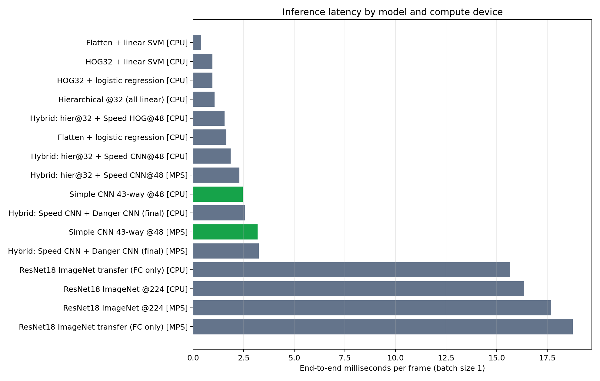

The timing experiment used 200 validation frames after 20 warm-up frames.
Measurements are end-to-end, batch size one, and include image I/O,
preprocessing, and prediction.

### Measurement computer

- **Computer:** MacBook Pro (MacBookPro18,1)
- **Chip / CPU:** Apple M1 Pro, 10 CPU cores
  - 8 performance cores
  - 2 efficiency cores
- **GPU:** Apple M1 Pro, 16 GPU cores
- **Unified memory:** 16 GB
- **Metal:** Metal 4
- **Python:** 3.14.2
- **PyTorch:** 2.12.1
- **MPS:** built and available

Selected latency results:

| Model | Device | ms/frame | FPS |
|---|---|---:|---:|
| Flattened pixels + linear SVM | CPU | 0.38 | 2,647 |
| HOG + linear SVM | CPU | 0.95 | 1,048 |
| Hierarchical linear | CPU | 1.05 | 950 |
| Hybrid Speed/Danger CNN | CPU | 2.55 | 392 |
| **Simple 43-way CNN** | **CPU** | **2.45** | **408** |
| **Simple 43-way CNN** | **MPS** | **3.18** | **314** |
| Frozen ResNet18 + FC | CPU | 15.68 | 64 |
| Frozen ResNet18 + FC | MPS | 18.77 | 53 |

The small CNN is easily fast enough for real-time recognition. CPU was faster
than MPS for these batch-size-one measurements because the network is small and
GPU dispatch/synchronization overhead dominates. This does not imply that CPU
will always be faster: larger networks and batched inference generally benefit
more from GPU execution.

These measurements cover recognition only. A production latency budget must
also include full-frame detection, tracking, camera transfer, and decision
logic.

## Conclusion

The best model for this ADAS recognition task is the **simple 43-way CNN at
48×48**. It provides the strongest safety-critical recall, the highest overall
validation and test performance, low batch-one latency, and a simpler
deployment path than the hierarchical hybrids.

The experiment also produced several practical lessons:

- Accuracy alone is not an adequate ADAS KPI; the worst critical-class recall
  reveals failure modes hidden by class imbalance.
- Track-aware validation is essential when several frames show the same
  physical sign.
- HOG is a strong, efficient classical feature. Raising resolution to 48×48
  and retuning SGD lifted minimum critical recall from 69.6% to 78.9%, but
  digit-level speed-limit confusion remains a ceiling that the CNN clears.
- Frozen ImageNet features are not automatically superior for a specialized,
  low-resolution domain.
- A purpose-built small CNN can outperform a heavier transfer-learning model
  while also running much faster.

## Future work

1. **Add full-frame detection.** Combine the classifier with a traffic-sign
   detector, for example using GTSDB or a modern detection dataset.
2. **Calibrate confidence and tune the abstention threshold on validation.**
   The abstention curves above show the trade-off exists and is usable; the
   remaining work is choosing the operating point on held-out data and checking
   whether the softmax scores are calibrated rather than merely well ordered.
3. **Use temporal evidence.** Aggregate predictions across consecutive video
   frames to reduce flicker and recover from blur or partial occlusion. This is
   also what makes abstention cheap: a declined frame costs nothing if the next
   frame answers.
4. **Target weak classes.** Add hard examples and focused augmentation for
   bumpy-road, ice/snow, general-caution, and roundabout signs.
5. **Test domain robustness.** Evaluate night, rain, glare, damaged signs,
   camera changes, geographic shifts, and adversarial stickers.
6. **Optimize edge deployment.** Benchmark quantization, TorchScript/ONNX,
   memory use, power draw, and sustained thermals on the actual target device.
7. **Separate recognition from action policy.** Classification should inform,
   not directly control, the vehicle; map context and other sensors should
   confirm safety-critical actions.

## Reproducing the project

The main notebooks are:

- `gtsrb_eda.ipynb` — exploratory analysis
- `gtsrb_flat_baseline.ipynb` — flattened-pixel baseline
- `gtsrb_baseline.ipynb` — HOG baselines and HOG hyperparameter sweep
- `gtsrb_hierarchical.ipynb` — six-group hierarchy
- `gtsrb_cnn_speed.ipynb` / `gtsrb_cnn_danger.ipynb` — specialists
- `gtsrb_simple_cnn.ipynb` — selected 43-class CNN
- `gtsrb_resnet18.ipynb` — frozen-backbone transfer learning
- `gtsrb_inference_timing.ipynb` — latency benchmark
