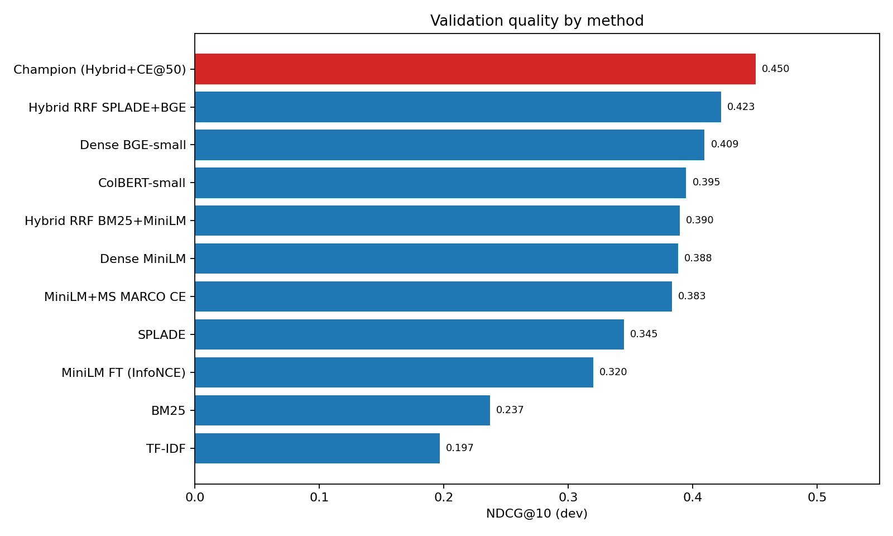
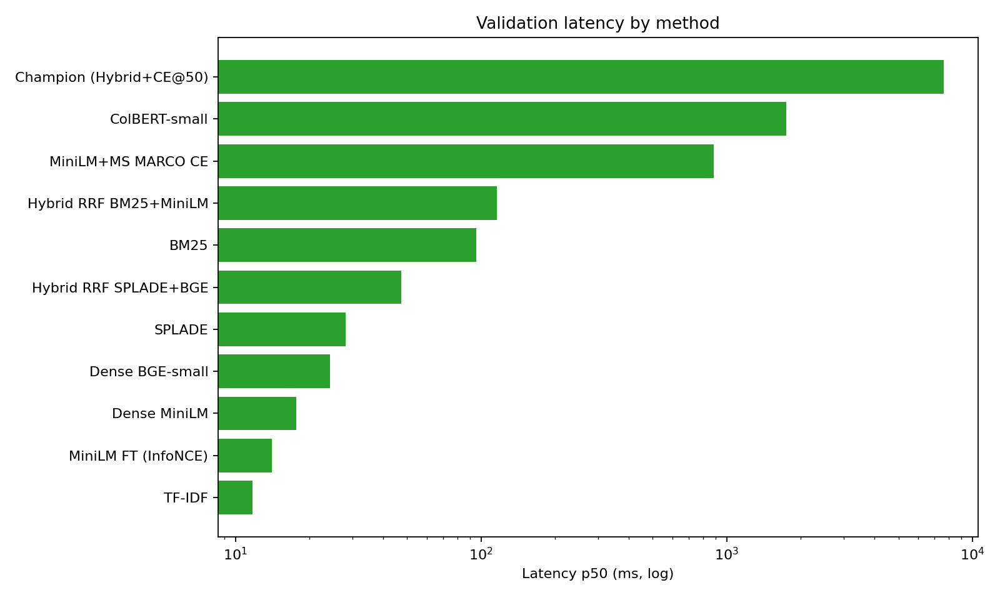
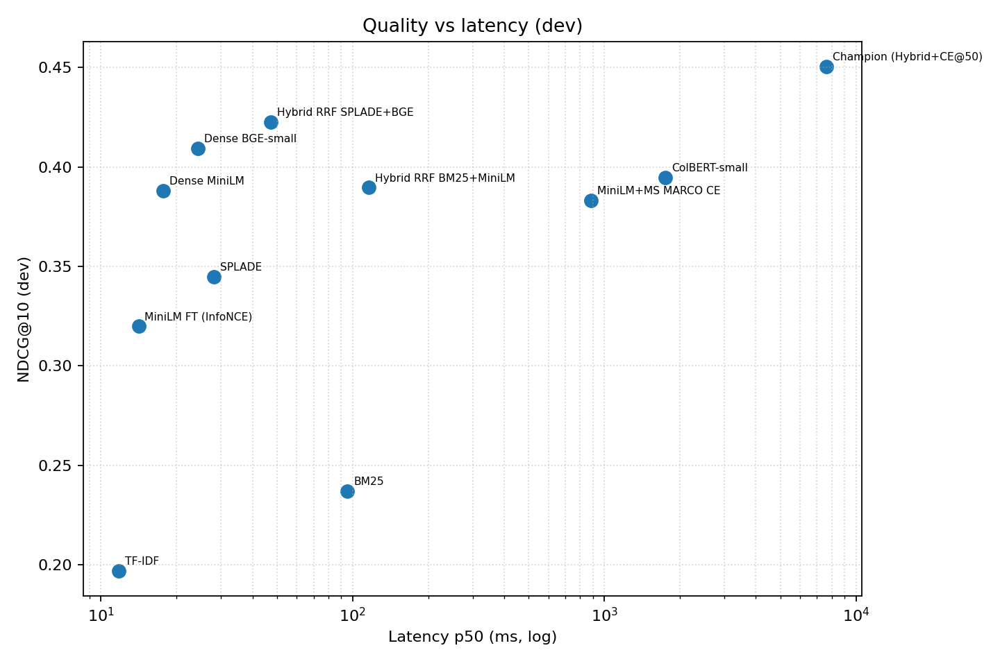
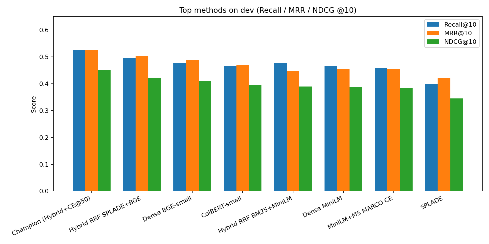
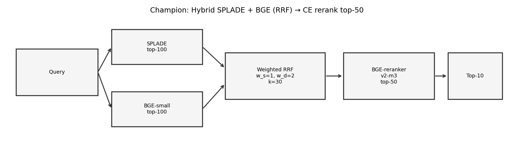

# Financial Retrieval on BEIR FiQA-2018

End-to-end retrieval study on the **FiQA-2018** subset of [BEIR](https://github.com/beir-cellar/beir): lexical → dense → hybrid → learned sparse → late interaction → cross-encoder reranking. Model selection used **dev only**; the **test** split was locked until the champion was chosen.

**Champion (dev-selected):** `hybrid_rrf_splade_bge+ce_v2m3_top50`  
SPLADE + BGE-small → weighted RRF → `BAAI/bge-reranker-v2-m3` on the top-50 pool.

| Split | Recall@10 | MRR@10 | NDCG@10 | Latency p50 |
|------:|----------:|-------:|--------:|------------:|
| **Dev** (n=500) | 0.526 | 0.525 | **0.450** | ~7.6 s |
| **Test** (n=648) | 0.496 | 0.521 | **0.433** | ~8.4 s |

Reproduce the winner with [`reproduce_champion.py`](reproduce_champion.py). Figures live under [`docs/figures/`](docs/figures/).

---

## 1. Problem and goal

**Problem.** Given a natural-language personal-finance question, retrieve the most relevant posts/answers from a large StackExchange-style finance corpus. Queries are short and often domain-specific (taxes, mortgages, options, forex); many have only one or a few judged relevant documents.

**Goal.** Maximize ranking quality at cutoff 10 under a fixed protocol:

- Primary metrics: **Recall@10**, **MRR@10**, **NDCG@10**
- **Dev** for all ablations and hyperparameter choices
- **Test** evaluated once for the final champion
- Prefer methods that improve quality without unnecessary FiQA-specific training when off-the-shelf models already work

---

## 2. Data

| Resource | Path | Size / notes |
|----------|------|----------------|
| Corpus | `fiqa/corpus/` | **57,638** passages; `title` is empty; body in `text` |
| Queries | `fiqa/queries/` | **6,648** queries |
| Qrels | `fiqa-qrels/{train,dev,test}.tsv` | binary relevance (`score > 0`) |

| Split | # queries with ≥1 relevant | # qrel rows |
|-------|----------------------------:|------------:|
| Train | 5,500 | 14,166 |
| Dev | 500 | 1,238 |
| Test | 648 | 1,706 |

Source: BEIR FiQA-2018 (CC-BY-SA-4.0). Titles are unused; all indexing uses document `text`.

---

## 3. Metrics and formulas

For a query \(q\) with relevant set \(R_q\) and ranked list \(d_1,\ldots,d_n\):

**Recall@k**

\[
\mathrm{Recall}@k(q)=\frac{|\{d_1,\ldots,d_k\}\cap R_q|}{|R_q|}
\]

**MRR@k** (first relevant rank \(r^*\); 0 if none in top-\(k\))

\[
\mathrm{MRR}@k(q)=\begin{cases}
1/r^* & \text{if } r^*\le k\\
0 & \text{otherwise}
\end{cases}
\]

**NDCG@k** (binary gains; DCG uses \(\log_2\))

\[
\mathrm{DCG}@k=\sum_{i=1}^{k}\frac{\mathbf{1}[d_i\in R_q]}{\log_2(i+1)},\quad
\mathrm{IDCG}@k=\sum_{i=1}^{\min(|R_q|,k)}\frac{1}{\log_2(i+1)},\quad
\mathrm{NDCG}@k=\frac{\mathrm{DCG}@k}{\mathrm{IDCG}@k}
\]

Reported scores are **macro-averages** over queries in the split. Latency is query end-to-end wall time (p50 / p95); for CE systems, end-to-end ≈ first-stage hybrid p50 + CE time.

---

## 4. Methods

Dev leaderboard (quality vs latency):









Summary of every approach tried (dev NDCG@10 in parentheses):

### Lexical

| Method | Trained on FiQA? | Pros | Cons | Dev NDCG@10 |
|--------|------------------|------|------|------------:|
| **TF-IDF + cosine** | Fit IDF on corpus only (unsupervised) | Fast, cheap, strong baseline | Weak on paraphrases / vocabulary mismatch | 0.197 |
| **BM25** (`rank_bm25`) | No (classic IR) | Better term weighting than TF-IDF; robust | Same lexical limits | 0.237 |

### Dense bi-encoders

| Method | Trained on FiQA? | Pros | Cons | Dev NDCG@10 |
|--------|------------------|------|------|------------:|
| **MiniLM** (`all-MiniLM-L6-v2`) | No (pretrained ST) | Large jump over BM25; low latency | Generic English, not finance-tuned | 0.388 |
| **MiniLM + InfoNCE FT** (BM25 hard negatives) | **Yes** (train qrels) | Domain adaptation in principle | **Hurt** quality here (overfit / weak negatives) | 0.320 |
| **E5-small-v2** | No | Strong general retriever | Slightly below MiniLM on this split | 0.383 |
| **BGE-small-en-v1.5** | No | Best single dense; uses instruction query prefix | Heavier encode than MiniLM | **0.409** |

### Hybrids (RRF)

Reciprocal Rank Fusion with constant \(k_{\mathrm{rrf}}\):

\[
\mathrm{RRF}(d)=\sum_{m\in\mathcal{M}} w_m\cdot\frac{1}{k_{\mathrm{rrf}}+\mathrm{rank}_m(d)}
\]

| Method | Trained on FiQA? | Pros | Cons | Dev NDCG@10 |
|--------|------------------|------|------|------------:|
| BM25 + MiniLM RRF (tuned weights) | No (weights on **dev**) | Complements sparse + dense | Extra index + latency | 0.390 |
| BM25 + BGE RRF | No | Same idea with stronger dense | Did not beat BGE alone on NDCG | 0.391 |
| **SPLADE + BGE RRF** (\(k=30\), \(w_s=1\), \(w_b=2\)) | No (weights on **dev**) | Best first-stage pool | Needs two indexes | **0.423** |

### Learned sparse / late interaction

| Method | Trained on FiQA? | Pros | Cons | Dev NDCG@10 |
|--------|------------------|------|------|------------:|
| **SPLADE** `naver/splade-cocondenser-ensembledistil` | No | Learns sparse expansions; good lexical recall | Alone weaker than BGE; slower encode | 0.345 |
| **ColBERT** `answerai-colbert-small-v1` (PLAID) | No | Fine-grained token matching | High latency / index size; below hybrid | 0.395 |

### Cross-encoder rerankers

| Method | Trained on FiQA? | Pros | Cons | Dev NDCG@10 |
|--------|------------------|------|------|------------:|
| MS MARCO MiniLM CE on MiniLM/hybrid | No | Cheap CE | Hurt / flat vs first stage | ≤0.383 |
| **`bge-reranker-v2-m3` on SPLADE+BGE top-50** | No | Strong pairwise scoring; best quality | ~7–8 s/query p50 on MPS | **0.450** |
| Same CE on top-100 | No | Larger pool | Slightly worse + much slower | 0.445 |

**Training note.** Only Stage 5a (MiniLM InfoNCE) trained on FiQA train. All other neural models are **off-the-shelf** pretrained checkpoints; the only FiQA-specific “learning” for the champion is **dev-selected RRF weights and CE pool size**.

---

## 5. Champion method



**Name:** `hybrid_rrf_splade_bge+ce_v2m3_top50`

1. **SPLADE** retrieve top-100  
2. **BGE-small** retrieve top-100 (query prefixed with  
   `Represent this sentence for searching relevant passages: `)  
3. **Weighted RRF:** \(k_{\mathrm{rrf}}=30\), \(w_{\mathrm{SPLADE}}=1\), \(w_{\mathrm{BGE}}=2\) → candidate pool  
4. **`BAAI/bge-reranker-v2-m3`** scores the **top-50** of that pool; sort by CE score for the final list  

### Dev (selection) vs test (locked)

| | Recall@10 | MRR@10 | NDCG@10 | Latency p50 |
|--|----------:|-------:|--------:|------------:|
| Dev | 0.526 | 0.525 | 0.450 | ~7631 ms |
| Test | 0.496 | 0.521 | 0.433 | ~8361 ms |

Artifacts: SPLADE CSR + BGE npy under `artifacts/`; hybrid pools under `artifacts/stage7a_ce_hybrid/`; metrics in `results/stage7a_*.csv` and `results/champion_test_metrics.*`. Test NDCG is slightly below dev (0.433 vs 0.450), which is expected for a locked holdout after selection.

### Example: correct retrieval (dev)

**Query** (`id=1`): *Claiming business expenses for a business with no income*  
Champion **NDCG@10 = 1.0**, **MRR@10 = 1.0**. Gold doc `14255` ranked **#1** (CE ≈ 0.95):

> Yes you can claim your business deductions if you are not making any income yet. But first you should decide what structure you want to have for your business…

### Example: failure (dev)

**Query** (`id=10054`): *Is there an academic framework for deciding when to sell in-the-money call options?*  
**NDCG@10 = 0**. Golds `190746` / `131989` never enter the RRF top-50, so the CE cannot recover them. Top CE hits are generic call-option explainers (e.g. `176883`), not the judged answers. Same first-stage miss pattern on `10048` (mortgage vs invest). Full traces: `results/readme_qualitative_examples.json`.

---

## 6. Future work

- **Stronger first-stage recall** (multi-vector / ColBERT in the RRF mix, larger pools with cheaper CE, or query expansion) to cut first-stage misses  
- **FiQA-aware fine-tuning** of BGE/SPLADE or the CE with careful hard-negative mining (prior MiniLM FT failed — revisit data and loss)  
- **Latency:** distill CE, cache embeddings, ANN (FAISS/HNSW) for BGE, inverted index for SPLADE; cascade (cheap CE → expensive CE)  
- **Calibrated fusion** (learned RRF / score normalization) instead of fixed weights  
- **Error analysis** by query type (options, tax, mortgage) and targeted adapters  

---

## 7. Deploy, infer, and monitor drift

### Deploy

1. Precompute and ship indexes:  
   - `artifacts/splade_cocondenser_ensembledistil/doc_embeddings.npz`  
   - `artifacts/dense_sota_small/bge_small_en_v1_5/doc_embeddings.npy` (+ `doc_ids.json`)  
2. Serve three Hugging Face models (or ONNX/TensorRT exports): SPLADE, BGE-small, `bge-reranker-v2-m3`.  
3. API path: encode query → dual top-100 → RRF → CE top-50 → return top-\(k\).  
4. Prefer GPU for CE; CPU/MPS works but p50 is multi-second.

### Inference (reproduce script)

```bash
# one-off query
python reproduce_champion.py --query "How do capital gains affect AGI?"

# interactive
python reproduce_champion.py --interactive

# evaluate a split
python reproduce_champion.py --eval-split test --k 10

# locked test eval used for the README numbers
python scripts/eval_champion_test.py
```

If caches are missing, `reproduce_champion.py` encodes the full corpus once (slow).

### Data / concept drift checks

| Signal | How | Action |
|--------|-----|--------|
| Query length / vocab shift | Compare rolling query token stats vs FiQA train | Revisit query prefixes / expansion |
| Embedding drift | PSI / KS on BGE query embedding norms & PCA coords vs baseline window | Re-encode or refresh ANN |
| Score drift | Track CE score distribution and RRF pool overlap | Alert if mass shifts |
| Quality proxy | Shadow traffic labeled sample; periodic NDCG on held-out / human labels | Retrain / swap first-stage |
| Corpus growth | New docs without re-indexing | Incremental encode + rebuild ANN |

Log per-query: latency, first-stage overlap, CE top score, and whether the user clicked a result (online feedback).

---

## Project layout

```
fiqa/                  # corpus + queries (BEIR)
fiqa-qrels/            # train/dev/test judgments
artifacts/             # embeddings, hybrid pools, ColBERT index
results/               # stage leaderboards, per-query CSVs, examples
scripts/               # stage runners + eval_champion_test.py
docs/figures/          # README plots
reproduce_champion.py  # standalone winning pipeline
```

Stage notebooks/scripts follow `stage1` … `stage7a` (lexical → CE champion).
