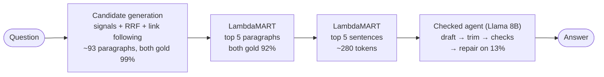
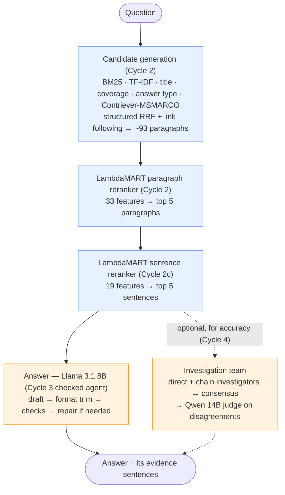

# HotpotQA: From RAG to Multi-Agent Investigation

Answering multi-hop questions over a Wikipedia corpus with a local LLM (Llama 3.1 8B via Ollama), on a laptop, with no LLM training. The project moves through cycles (EDA, then basic RAG, improved RAG, a single agent and a multi-agent system), measuring quality, evidence, unsupported answers, LLM calls, tokens and cost, and latency at every step.

**Status:** Cycles 0–4 done; final comparison on the 300 test questions in §5.
- **Cycle 2** (improved retrieval) raised EM from 0.383 to **0.483** with the same LLM; sending only the top 5 selected sentences (Cycle 2c) keeps that quality (0.503) at less than half the tokens and latency.
- **Cycle 3** (single agent: checks, repair, format trim) reaches **0.537** at 1.1 LLM calls and about 1.6 s median: the best value.
- **Cycle 4** (two investigators + a Qwen 14B judge) is the most accurate at **0.580**, significantly above every Llama-only system, but it doesn't beat Qwen 14B used alone in the Cycle 3 agent (0.573), at 5× the calls and 3.5× the median latency (9.5 s vs 2.7 s).

## Bottom line

**Winner: the Cycle 3 checked agent on Llama 3.1 8B, on top of the Cycle 2 / 2c retrieval stack.** Better retrieval plus a lightweight, rule-checked single agent beats a multi-agent team on value: spend on a stronger model before spending on more agents.



| | Winner: checked agent (Llama 8B) | Cycle 1 basic RAG | Upgrade: checked agent (Qwen 14B) | Most accurate: team, Qwen 14B judge |
|---|---|---|---|---|
| EM / F1 (300 test questions) | **0.537 / 0.676** | 0.383 / 0.527 | 0.573 / 0.722 | 0.580 / 0.719 |
| EM on dev (300 design questions, separate from test; see §3) | 0.583 | – | 0.583 | 0.627 |
| Unsupported answers | **3.0%** | 18.7% | 5.0% | 3.3% |
| LLM calls per question | **1.1** | 1 | 1.2 | 6.0 |
| Cost per 1,000 questions | **$0.018** | $0.036 | $0.148 | $0.254 |
| Latency p50 / p95 | **1.6 s / 4.1 s** | 3.0 s / 4.4 s | 2.7 s / 8.0 s | 9.5 s / 32.6 s |
| Won / lost vs the winner (test) | – | – | 33 / 22 (p = 0.18) | 16 / 3 (p = 0.004) |

- **Why it wins:** retrieval gave +10 EM at no extra LLM cost; the agent adds a significant +3.4 EM over Cycle 2c (13 won / 3 lost, p = 0.02) and halves unsupported answers at almost no extra latency. The best systems nearly reach the gold-paragraph ceiling (0.577).
- **If accuracy matters more than cost:** the same checked agent with Qwen 14B: +3.6 EM on test but not significant (and tied on dev), more unsupported answers (5.0%: the prompts were developed with Llama), 8× the cost and 2× the p95 latency.
- **Why not the team:** it is the most accurate (0.580) but doesn't beat Qwen 14B alone (26 / 24 on test), at 5× the calls and 3.5× the median latency.

Full comparison and recommendation: §5.

| Document | Contents |
|---|---|
| **This overview** | Business logic, KPIs, metrics and formulas, data and splits, the system at a glance, final comparison, recommendation |
| [docs/01_eda.md](docs/01_eda.md) | Cycle 0: dataset numbers, questions and answers, paragraphs, supporting facts, why hop 2 is hard, design decisions |
| [docs/02_candidates_and_reranking.md](docs/02_candidates_and_reranking.md) | Cycles 1, 2, 2c retrieval: single search, candidate generation, LambdaMART paragraph reranker, sentence reranker |
| [docs/03_answer_extraction.md](docs/03_answer_extraction.md) | Cycles 1–4 answering: basic RAG, improved RAG, sentence RAG, LangGraph agents, the investigation team |
| [docs/04_final_presentation.md](docs/04_final_presentation.md) | Final presentation: talk outline, mandatory comparison table, the five required cases, rejected technologies, answers to the assignment's "Questions you must be able to answer" |
| [docs/presentation.html](docs/presentation.html) | The same content as a slide deck: open in a browser, arrow keys to navigate, `P` to print to PDF |
---

## 1. Business logic: why retrieval is the core of RAG

**The use case.** An analyst asks a question whose answer is spread across two documents, e.g. *"In what year was the university where Sergei Tokarev was a professor founded?"* Answering it takes two steps: first find *Tokarev* (who taught at Moscow State University), then find *Moscow State University* (founded 1755). The second document is never named in the question. This is **multi-hop** question answering, typical of investigations, due diligence, support and research work.

**Why RAG and not the LLM alone?** Asked closed-book, Llama 3.1 8B gets 24% exact match. With retrieved paragraphs it gets 38%. The model doesn't reliably *know* the facts, but it can *read* them. RAG also makes answers **verifiable**: every answer can point to the paragraphs it came from.

**Why retrieval is the bottleneck:**
- **The answer is extractive.** For more than 99% of non-yes/no questions, the answer appears word-for-word in a gold paragraph. If both gold paragraphs reach the LLM, answering is mostly picking the right span.
- **If a gold paragraph is missing, the LLM can't answer correctly.** It either says "unknown" or, worse, **makes up an answer** (an unsupported answer).
- **Hop 2 is the hard part.** Its title is named in the question only 14% of the time, and in 53% of bridge questions a distractor overlaps the question more than hop 2 does.

So every point of **both-gold recall** is a ceiling on answer quality, and the first thing to optimize.

### KPIs

| KPI | Business meaning | Metric |
|---|---|---|
| **Answer quality** | Is the answer right? | EM, F1 |
| **Evidence quality** | Did the system see what it needed? Can the answer be audited? | Both-gold recall@K, evidence recall@K |
| **Trust / hallucination** | How often does it answer from outside the evidence? | Unsupported-answer rate |
| **Cost** | Money per 1,000 questions | Tokens, LLM calls, estimated $ |
| **Responsiveness** | User waiting time, especially the slow tail | Latency p50 / p95 |
| **Complexity** | Engineering and maintenance burden | Components, calls per question, tuning effort |

---

## 2. Metrics and formulas

Notation: for a question $q$, $G_q$ is its set of gold paragraphs (always 2 in HotpotQA), $R_q^K$ the top-K retrieved paragraphs, and $Q$ the evaluation questions.

### Retrieval metrics (no LLM involved)

**Both-gold recall@K**, *the main retrieval metric*: the share of questions for which **all** gold paragraphs are in the top K.
$$\text{Both@}K = \frac{1}{|Q|}\sum_{q\in Q} \mathbb{1}\left[G_q \subseteq R_q^K\right]$$

**Evidence recall@K**: the share of gold paragraphs found, giving partial credit when only one of two is found.
$$\text{Recall@}K = \frac{1}{|Q|}\sum_{q\in Q} \frac{|G_q \cap R_q^K|}{|G_q|}$$

**Hop-1 / hop-2 found@K** (bridge questions): the share of questions whose hop-1 (resp. hop-2) gold paragraph is in the top K. Hop 2 is the paragraph containing the answer; ambiguous cases are excluded. This metric diagnoses *where* multi-hop retrieval breaks.

**Candidate recall**: Both@K where K is the whole candidate pool of the reranker (about 93 paragraphs). It's the ceiling for any reranker: it can't return what isn't in its pool.

**All support kept** (sentence selection): the share of questions whose supporting sentences $S_q$ are all among the selected sentences $\hat S_q$.
$$\text{AllSupport} = \frac{1}{|Q|}\sum_{q\in Q} \mathbb{1}\left[S_q \subseteq \hat S_q\right]$$

### Answer metrics (official HotpotQA definitions)

Answers are normalized first: lowercase, strip punctuation and the articles *a/an/the*, collapse whitespace.

**Exact match**
$$\text{EM} = \mathbb{1}\left[\text{norm}(\hat a) = \text{norm}(a)\right]$$

**Token F1**: partial credit for overlapping words (yes/no answers must match exactly).
$$P = \frac{|\hat a \cap a|}{|\hat a|},\quad R = \frac{|\hat a \cap a|}{|a|},\quad F1 = \frac{2PR}{P+R}$$
where $\cap$ counts common tokens with multiplicity.

**Unsupported-answer rate**: the share of answers whose normalized text does *not* appear in the paragraphs given to the LLM. It's a proxy for hallucination; yes/no answers count as supported.
$$\text{Unsupported} = \frac{1}{|Q|}\sum_{q} \mathbb{1}\left[\text{norm}(\hat a_q) \not\subset \text{norm}(\text{context}_q)\right]$$

**Significance:** per-question sign test on EM between two systems: count the questions only one of them gets right (won / lost) and test against a 50/50 split (binomial test).

### Cost and latency

- **Tokens and calls:** prompt and completion tokens, retrieval calls and LLM calls per question.
- **Estimated cost:** $\text{cost} = (\text{prompt tokens}\times p_{in} + \text{completion tokens}\times p_{out})/10^6$. Local inference is free, so for comparability we use hosted reference prices: Llama 3.1 8B $0.05 / $0.08 and Qwen2.5 14B $0.35 / $1.40 per 1M tokens.
- **Latency:** wall-clock time per question for retrieval, the LLM and the total, reported as **p50** (typical) and **p95** (slow tail: what users complain about). Rate-limit waits are tracked separately and never counted.

### Which metric matters most at each step

| Pipeline step | Primary metric | Why | Secondary |
|---|---|---|---|
| **Candidate generation** | **Candidate recall** | A gold paragraph missing here is lost for good; order doesn't matter yet | Pool size (cost of the next stage) |
| **Reranking** | **Both-gold recall@5** | The LLM sees the top 5; multi-hop needs *both* paragraphs, so a single miss already breaks the answer | Both@2 (small contexts), hop-2 found@5 (diagnosis), retrieval latency p95 |
| **Sentence selection** | **All support kept** | One dropped supporting sentence costs about 21 EM points on that question | Supporting-sentence recall, words kept |
| **Answer generation** | **EM** (headline), **F1** | EM is the official metric; F1 forgives wording differences ("Dara Torres" vs "Dara Grace Torres") | Unsupported rate: a wrong answer grounded in context is better than an invented one |
| **Whole system** | **EM at an acceptable cost and p95 latency** | The business trade-off | LLM calls per question, tokens, complexity |

**Why both-gold@5 and not recall@5?** A question with one of two gold paragraphs gets 50% recall but usually 0% answer accuracy. Both-gold matches how multi-hop answers actually succeed or fail.

---

## 3. Data and splits

Details and figures: [docs/01_eda.md](docs/01_eda.md).

- **Dataset:** HotpotQA (Yang et al., 2018), *distractor* setting, validation split (7,405 questions), loaded from the Hugging Face Hub ([`hotpotqa/hotpot_qa`](https://huggingface.co/datasets/hotpotqa/hotpot_qa), config `distractor`); license CC BY-SA 4.0. Questions were written by crowd workers over pairs of English Wikipedia articles, with the supporting sentences annotated; the 8 distractors per question were retrieved by TF-IDF from Wikipedia. Each question comes with 10 paragraphs: 2 gold and 8 distractors chosen to look relevant. 80% of questions are **bridge** (find entity A, then use it to find the answer) and 20% are **comparison** (look up two named entities and compare them).
- **Pool:** 2,000 questions sampled with seed 42.
- **Closed corpus:** all the pool's paragraphs, de-duplicated: **19,260 paragraphs** (about 1.7M words; 3,904 are gold for some question). One paragraph = one chunk, with its title prepended; median 79 words (gold paragraphs: 62). Each question must find its 2 gold paragraphs among all 19,260.
- **Splits.** Test questions are never used for design decisions (exceptions listed in §7).

| Split | Questions | Used for |
|---|---|---|
| **Test** `pool[:500]` | 500 | Every reported retrieval number; the first 300 for every LLM run (the LLM is the slow part) |
| **Train** `pool[500:1500]` | 1,000 | Training the LambdaMART paragraph and sentence rankers |
| **Tuning** `pool[1500:2000]` | 500 | RRF weights, BM25 parameters, LambdaMART early stopping and hyperparameters; its first 300 ("dev") for designing the Cycle 3–4 agents |

No LLM is trained; the only trained models are the two small LambdaMART rankers (about 1 s each on a laptop).

---

## 4. The system at a glance



Blue = retrieval ([docs/02](docs/02_candidates_and_reranking.md)), orange = answer extraction ([docs/03](docs/03_answer_extraction.md)).

| Cycle | Best method | Test EM | What it changed |
|---|---|---|---|
| 0 | EDA | – | Chunk = paragraph; both-gold recall as the retrieval KPI; hop 2 is the hard part |
| 1 | BGE top 5 + Llama | 0.383 | Retrieval +14 EM over closed book; 32% still miss a gold paragraph |
| 2 | Candidates + LambdaMART + Llama | 0.483 | Both@5 0.706 → 0.924; retrieval failures 24% → 5% |
| 2c | + sentence reranker | 0.503 | Same quality at 57% fewer tokens, half the latency |
| 3 | Checked agent (LangGraph) | 0.537 | Format trim + checks + repair; unsupported answers halve |
| 4 | Team with Qwen 14B judge | 0.580 | Most accurate; matches Qwen 14B alone at 3.5× its latency |

---

## 5. Final comparison

All cycles on the 300 test questions:

| Cycle | System | EM | F1 | Both gold in context | Unsupported | LLM calls | Prompt tokens | Cost / 1k | Latency p50 / p95 |
|---|---|---|---|---|---|---|---|---|---|
| 0 | Closed book (100 questions) | 0.24 | 0.33 | – | – | 1 | 99 | $0.005 | 0.35 s / 0.57 s |
| 1 | RAG: BGE top 5 | 0.383 | 0.527 | 68% | 18.7% | 1 | 716 | $0.036 | 3.0 s / 4.4 s |
| 1 | RAG: Contriever-MSMARCO top 5 | 0.347 | 0.462 | 57% | 10.7% | 1 | 719 | $0.036 | *3.6 s / 5.5 s* |
| 2 | LTR classical, 5 paragraphs | 0.457 | 0.606 | 89% | 5.3% | 1 | 646 | $0.033 | *3.3 s / 4.7 s* |
| 2 | LTR + Contriever, 5 paragraphs | 0.483 | 0.636 | 91% | 6.0% | 1 | 647 | $0.033 | 3.7 s / 5.0 s |
| 2c | LTR + Contriever, top 5 sentences | 0.503 | 0.654 | 80% | 6.0% | 1 | 281 | $0.014 | 1.5 s / 2.0 s |
| 3 | **Checked agent (Llama 8B)** | **0.537** | 0.676 | 84% | 3.0% | 1.11 | 357 | $0.018 | **1.6 s / 4.1 s** |
| 3 | Decomposed agent (Llama 8B) | 0.533 | 0.686 | 94% | 2.3% | 4.24 | 1,438 | $0.076 | 6.6 s / 10.0 s |
| 3 | Checked agent, Qwen 14B (control) | 0.573 | 0.722 | 85% | 5.0% | 1.16 | 402 | $0.148 | 2.7 s / 8.0 s |
| 4 | Self-consistency, 5 samples (control) | 0.527 | 0.673 | 84% | 2.0% | 5.11 | 1,482 | $0.076 | 2.3 s / 4.0 s |
| 4 | Team, 8B judge | 0.563 | 0.702 | 85% | 3.0% | 5.96 | 2,199 | $0.115 | 7.0 s / 13.6 s |
| 4 | **Team, 14B judge** | **0.580** | **0.719** | 87% | 3.3% | 5.96 | 2,213 | $0.254 | 9.5 s / 32.6 s§ |
| – | Oracle: gold paragraphs (ceiling) | 0.577 | 0.736 | 100% | 3.3% | 1 | 307 | $0.016 | *1.3 s / 2.0 s* |
| – | Oracle: gold supporting sentences | 0.593 | 0.759 | 100% | 4.3% | 1 | 197 | $0.010 | *1.0 s / 1.5 s* |

Latency comes from the clean benchmark below (first 50 test questions, one session, LLM cache off); *italic* rows weren't re-timed and keep their main-run values. § Includes swapping Llama and Qwen in and out of GPU memory on every disagreement. "Both gold in context" counts the paragraphs behind the final answer's evidence.

**Clean latency benchmark.** The main runs were timed in different sessions (machine state, overlapping Ollama runs) and partly replayed from the LLM cache, so their latencies weren't comparable. `src/latency_bench.py` re-times the systems live on the same 50 test questions, one system after another in a single session, after a 2-question warm-up. Ollama is emptied before each system: it keeps a large in-memory prompt cache, and without the reset the checked agent (whose first prompt is the Cycle 2c prompt) ran 3× faster than Cycle 2c on identical prompts.

| System | LLM calls | Seconds per call | p50 | p95 | p50 vs checked agent |
|---|---|---|---|---|---|
| Cycle 2c, top 5 sentences | 1.00 | 1.43 | 1.5 s | 2.0 s | 1.0× |
| Checked agent (Llama 8B) | 1.08 | 1.58 | 1.6 s | 4.1 s | – |
| Self-consistency, 5 samples | 5.08 | 0.47 | 2.3 s | 4.0 s | 1.4× |
| Checked agent, Qwen 14B | 1.12 | 2.55 | 2.7 s | 8.0 s | 1.7× |
| Decomposed agent | 4.18 | 1.58 | 6.6 s | 10.0 s | 4.2× |
| Team, 8B judge | 5.66 | 1.32 | 7.0 s | 13.6 s | 4.5× |
| Team, 14B judge (with model swaps) | 5.66 | 2.18 | 9.5 s | 32.6 s | 6.0× |

- **Qwen 14B alone is much faster than the main run suggested:** 2.7 s / 8.0 s, not 10.6 s / 21.9 s; that run was slowed by memory pressure from other Ollama runs. It costs 1.7× the checked agent's median latency, against 6× for the 14B-judge team.
- **The team's slow tail comes from the judge.** The 11 of 50 questions that reach the judge take a median 25.6 s (model swaps included) vs 8.3 s for the others; that is the 32.6 s p95.
- **Self-consistency is cheaper than its call count suggests:** its 5 samples share one prompt, which Ollama processes once (0.47 s per call).
- **The checked agent's repair call costs nothing at the median** (1.6 s vs 1.5 s for Cycle 2c) and shows only in the tail (p95 4.1 s vs 2.0 s).
- **Resolution: about 20%.** Even in one quiet session the machine drifts. Run sequentially, Cycle 1 BGE looked faster than Cycle 2 paragraphs (3.0 s vs 3.7 s); alternating the two question by question on 30 questions reversed it (3.5 s vs 3.1 s, consistent with Cycle 2's shorter prompts). Ratios above about 1.5× are robust; smaller gaps are not.

Per-question significance (sign test on EM):

| Comparison (test) | Won / lost | p |
|---|---|---|
| Cycle 2 paragraphs vs Cycle 1 BGE | 43 / 13 | < 0.001 |
| Checked agent vs Cycle 2c | 13 / 3 | 0.02 |
| Team (14B judge) vs checked agent | 16 / 3 | 0.004 |
| Team (14B judge) vs self-consistency | 24 / 8 | 0.007 |
| Team (14B judge) vs Qwen 14B alone | 26 / 24 | 0.89 |
| Qwen 14B alone vs checked agent (Llama) | 33 / 22 | 0.18 |

**What the comparison says:**
1. **Retrieval was the biggest lever:** +10 EM points from Cycle 1 to Cycle 2 at no extra LLM cost. The best systems nearly reach the gold-paragraph oracle (0.577).
2. **The checked agent is the best value:** +5.4 EM over the Cycle 2 paragraphs (+3.4 over 2c), half the cost of Cycle 1, the same median latency as Cycle 2c (1.6 s, about half of Cycles 1–2), and half the unsupported answers of the Cycle 2 systems (3.0% vs 6.0%). Two deterministic steps (format trim, checks) do most of the work.
3. **The 14B-judge team is the most accurate system (0.580)** and significantly beats every Llama-only system, including self-consistency at similar call counts: two investigators that fail differently plus a judge that reads the evidence. It closes about half of the gap to the two-investigator upper bound (judge right on 41 of the 55 test disagreements with exactly one right answer; always taking the direct answer: 28).
4. **But it doesn't beat the bigger model used alone.** Qwen 14B as a single checked agent reaches 0.573 (dev: 0.583, same as Llama). Team vs Qwen alone is 33 / 20 on dev and 26 / 24 on test (pooled p ≈ 0.17): no demonstrated advantage for the multi-agent structure over simply using the larger model, which needs 1.2 calls instead of 6 and no model swapping.
5. **More calls without diversity don't help:** self-consistency (5 samples) is no better than one answer.

**How it compares with published work.** Fine-tuned HotpotQA readers reach about 0.70 EM in the distractor setting, and prompted LLMs over full Wikipedia typically 0.30–0.45. Our closed 19k-paragraph corpus sits between those settings, and a zero-shot 8B model can't be compared directly with either; the relevant ceiling is our own oracle (0.577 with the gold paragraphs), which the best systems reach.

**Recommendation.**
- **Default:** the Cycle 3 checked agent on Llama 3.1 8B: EM 0.537, 1.1 calls, about 1.6 s median, $0.018 per 1,000 questions, 3% unsupported.
- **If accuracy matters more than cost:** a stronger model in the same checked agent (Qwen 14B: +3.6 EM, not significant on 300 questions; 2.7 s / 8.0 s) is simpler than the team for the same quality, at a third of its median latency and a quarter of its p95.
- **The team** is worth it only where a single strong model isn't available for every question but a stronger *verifier* can be used on the 30% of disagreements, e.g. a hosted judge, or batch investigations with a local judge.

---

## 6. Rejected technologies

Full tables with numbers: [retrieval](docs/02_candidates_and_reranking.md#rejected-retrieval-technologies) and [answer extraction](docs/03_answer_extraction.md#rejected-answer-extraction-technologies).

| Technology | Stage | Why rejected (short) |
|---|---|---|
| Full Wikipedia index (fullwiki) | Data | Beyond a laptop budget; a closed 19k corpus keeps the research question |
| BGE as the main retriever | Retrieval | Trained on the HotpotQA train split (unfair advantage); its lead vanishes inside LambdaMART |
| Unsupervised Contriever | Retrieval | Weaker than BM25 (0.470 vs 0.544) |
| Plain / weighted RRF as the final ranker | Retrieval | Barely beats BM25 (0.576); no confidence or interactions |
| Always-on backlinks | Retrieval | Push correct forward links out of the top 5; left to LambdaMART |
| Stemming, GloVe soft matching, title aliases | Retrieval | Tiny coverage gains, noisy links, heavy dependencies |
| Cross-encoder reranker | Retrieval | Not tested: deprioritized once LambdaMART reached 0.924 of a 0.992 ceiling; it can't use links |
| TF-IDF / "1 per paragraph" / top-8 sentence selection | Sentences | Keep less evidence (36% / 48%) or add noise (top 8: EM 0.487 vs 0.503) |
| Free-form ReAct agent | Agent | An 8B model plans tool calls unreliably; a fixed LangGraph flow is measurable |
| Decomposition as the main agent | Agent | 4× calls and latency for no gain; kept as the second investigator |
| Self-consistency | Agent | 4.6× calls, no gain: samples share the same mistakes |
| 8B judge, rule-based judge | Team | Position bias and leniency; rules separate only 11 of 91 disagreements |

---

## 7. Caveats

Stage-specific caveats are in [docs/02](docs/02_candidates_and_reranking.md#retrieval-caveats) and [docs/03](docs/03_answer_extraction.md#answer-extraction-caveats).

- **Closed corpus.** 19,260 paragraphs built from the pool's contexts; numbers don't transfer directly to full Wikipedia.
- **Test-set decisions.** Two Cycle 2 choices were made after seeing test numbers: the final retriever variant (chosen for BGE's contamination, not its 0.004 gap) and top 5 over top 8 sentences (0.503 vs 0.487, not significant). All Cycle 3–4 design choices were made on dev.
- **Sample size.** 300 questions give ±2.8 EM points of standard error (47 comparison questions, so one comparison question ≈ 2 points); differences among the top systems need the sign tests.
- **Latency resolution.** Per-call latency varied by about 25% between sessions and drifts by up to about 20% within one. The final table uses the clean single-session benchmark (50 questions); treat latency gaps under about 1.5× as noise. Latencies in the per-cycle documents come from the main runs.
- **Prompts were developed with Llama.** The Qwen 14B runs reuse the same prompts; a model-specific prompt could change its numbers.

---

## 8. Next steps

1. **Sentence-selector recall.** When all supporting sentences are kept, EM is 0.576; the selector keeps them for 75% of questions. Higher recall would lift every system built on it.
2. **A better hop 1.** The chain investigator wins 7 points when its bridge entity is right; verifying hop 1 (and retrying with the second-best entity) attacks its main failure.
3. **A larger evaluation** (e.g. 1,000 questions) to settle the differences among the top systems, in particular team vs Qwen 14B alone.

---

## 9. Reproducing

**Environment**
- Python 3.14 virtual environment in `.venv`.
- Ollama running `llama3.1` locally (for the RAG cycles).
- LangGraph (`pip install langgraph`, tested with 1.2.12) for the Cycle 3–4 agents.
- For the Cycle 4 judge and the Qwen control: `ollama pull qwen2.5:14b`. On a 16–18 GB machine it can't share GPU memory with Llama; the team runner unloads Llama before judging.
- In VS Code, choose the Jupyter kernel **"hotpotQA (.venv, Python 3.14)"**.
- `.env` holds API keys, is git-ignored and must never be committed.

```bash
source .venv/bin/activate
python -m src.rag retrieval --retriever contriever_msmarco   # Cycle 1 single-search retrievers (also: dense, contriever, bm25, tfidf)
python -m src.rag rag --n 300                                # Cycle 1 RAG with Llama
python -m src.fusion                                         # Cycle 2 classical RRF rankers + ablations
python -m src.fusion --dense                                 # Cycle 2 dense + links, hybrid
python -m src.ltr                                            # Cycle 2 LambdaMART: 3 variants, ablation, learning curve (~6 min)
python -m src.rag rag --n 300 --retriever ltr_hybrid_contriever_msmarco   # Cycle 2 RAG (also: ltr_classical, oracle; ~20 min each)
python -m src.sentences                                      # Cycle 2c sentence reranker: train + offline evidence recall (~4 min)
python -m src.rag rag --n 300 --retriever ltr_hybrid_contriever_msmarco --sentences ltr5   # Cycle 2c RAG (also: ltr8, ltr5_min1; oracle sentences: --retriever oracle --sentences oracle)
python -m src.agent checked --split test                     # Cycle 3 checked agent (also: decomposed, self_consistency; --model qwen2.5:14b; --split dev for design runs)
python -m src.team --judge pairwise --judge-model qwen2.5:14b --split test   # Cycle 4 team (also: --judge pointwise; no --judge-model = 8B judge)
python -m src.latency_bench --n 50                           # clean latency benchmark, all systems live in one session (~45 min; nothing else on Ollama)
```

Notes:
- LightGBM and PyTorch clash on macOS (their OpenMP runtimes deadlock or segfault). Training uses `n_jobs=1`. To load a saved model, `load_ltr_retriever` sets `OMP_NUM_THREADS=1` and must run before PyTorch is imported; retrieval latency is unaffected.
- For offline runs with cached models, set `HF_HUB_OFFLINE=1`.

### Citation

The dataset ([project page](https://hotpotqa.github.io), [paper](https://aclanthology.org/D18-1259/)):

> Zhilin Yang, Peng Qi, Saizheng Zhang, Yoshua Bengio, William W. Cohen, Ruslan Salakhutdinov and Christopher D. Manning. 2018. *HotpotQA: A Dataset for Diverse, Explainable Multi-hop Question Answering.* In Proceedings of the 2018 Conference on Empirical Methods in Natural Language Processing (EMNLP), pages 2369–2380.

```bibtex
@inproceedings{yang2018hotpotqa,
  title     = {{HotpotQA}: A Dataset for Diverse, Explainable Multi-hop Question Answering},
  author    = {Yang, Zhilin and Qi, Peng and Zhang, Saizheng and Bengio, Yoshua and Cohen, William W. and Salakhutdinov, Ruslan and Manning, Christopher D.},
  booktitle = {Proceedings of the 2018 Conference on Empirical Methods in Natural Language Processing},
  pages     = {2369--2380},
  year      = {2018},
  url       = {https://aclanthology.org/D18-1259/}
}
```

### Project layout

| Path | Contents |
|---|---|
| `docs/` | Topic documents (EDA, candidates and reranking, answer extraction, final presentation), the HTML slide deck, and diagrams in `docs/figures/` |
| `src/data.py` | Dataset loading, fixed pool, corpus, hop labels |
| `src/classical.py` | BM25, TF-IDF |
| `src/retrievers.py` | Dense retrievers (BGE, Contriever, Contriever-MSMARCO) |
| `src/entities.py` | Question entities, title gazetteer, aliases, links, backlinks, fuzzy titles |
| `src/fusion.py` | RRF, structured ranker (routing, slots, links) |
| `src/ltr.py` | LambdaMART: candidates, features, training, retriever |
| `src/sentences.py` | Sentence reranker: features, training, selection policies, offline evaluation |
| `src/agent.py` | Cycle 3 agents as LangGraph graphs (checked, decomposed) and the self-consistency control; also an earlier multi-judge prototype, superseded by `src/team.py` |
| `src/team.py` | Cycle 4 investigation team: two investigators, consensus, judge (pairwise or pointwise, optional stronger judge model) |
| `src/judge_eval.py` | Offline comparison of judge prompt variants on the dev disagreements |
| `src/latency_bench.py` | Clean latency benchmark: every system live (LLM cache off) on the same questions in one session |
| `src/rag.py`, `src/llm.py`, `src/evaluate.py` | RAG pipeline, LLM client (Ollama/Groq, cached), metrics |
| `notebooks/00_eda`, `01_baseline_rag`, `02_classical_ranking`, `03_improved_rag` | Analyses with findings (`.py` sources, `.ipynb` executed) |
| `results/` | Per-question JSONL for every run, summary CSVs, figures |
| `cache/` | Embeddings, entity/link indexes, LTR features and models, LLM responses |
