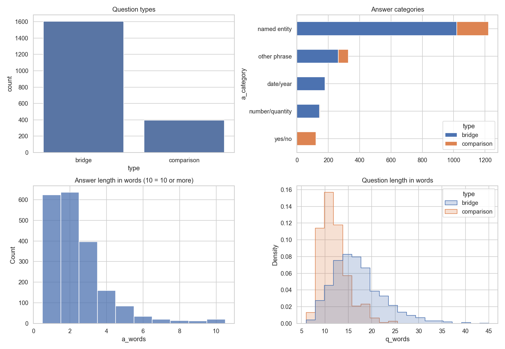
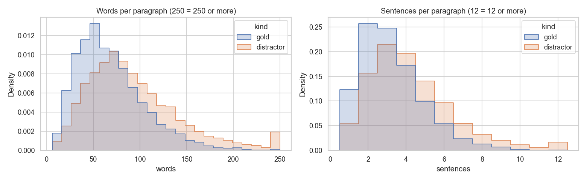
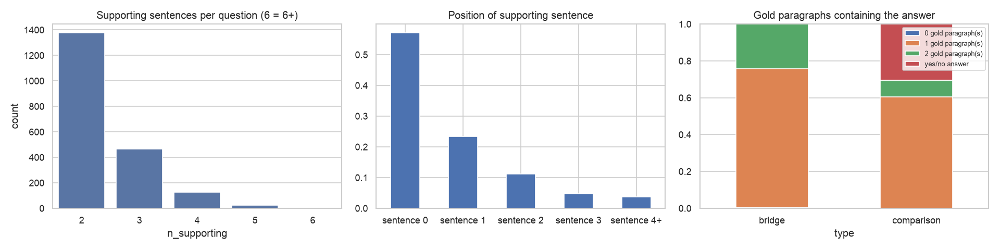
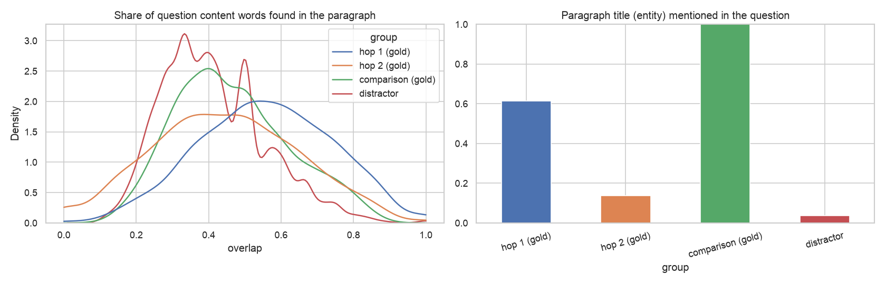

# Cycle 0: Exploratory data analysis

[← Overview](../README.md) · **EDA** · [Candidates and reranking](02_candidates_and_reranking.md) · [Answer extraction](03_answer_extraction.md)

**Goal:** understand the data well enough that every later decision (chunking, top-K, retriever, metrics, agent design) rests on something measured. Source: `notebooks/00_eda.ipynb`.

---

## 1. The dataset in numbers

**Source.** HotpotQA (Yang et al., 2018, EMNLP; [project page](https://hotpotqa.github.io), [paper](https://aclanthology.org/D18-1259/)), loaded from the Hugging Face Hub as [`hotpotqa/hotpot_qa`](https://huggingface.co/datasets/hotpotqa/hotpot_qa), config `distractor`, split `validation` (`src/data.py`). License CC BY-SA 4.0. Crowd workers wrote each question over a pair of English Wikipedia articles and marked the supporting sentences; the 8 distractor paragraphs per question were retrieved automatically by TF-IDF (bigram) search over Wikipedia, which is why they resemble the question. Full citation in the [overview](../README.md#citation).

| | Count |
|---|---|
| HotpotQA *distractor* validation split | 7,405 questions |
| **Our pool** (random sample, seed 42) | **2,000 questions** |
| Paragraphs per question | 10 (2 gold + 8 distractors); 1,985 of 2,000 questions have all 10 |
| Paragraph slots in the 2,000 contexts | 19,908 |
| **Corpus: unique paragraphs** (de-duplicated by title) | **19,260** (about 1.7M words) |
| Gold paragraphs (for some question) | 3,904 |
| Distractor-only paragraphs | 15,356 |
| Paragraphs shared by 2 or more questions | 598 |
| Question types | 1,604 bridge (80%), 396 comparison (20%) |
| Difficulty level | all *hard* (every validation question), so not analyzed |

**Why a closed corpus.** Retrieving among a question's own 10 paragraphs is too easy to be realistic. We pool the paragraphs of all 2,000 questions into a mini-Wikipedia: each question must find its 2 gold paragraphs among 19,260, including the look-alike distractors chosen for *other* questions. A random paragraph has a 0.01% chance of being one of them. The full Wikipedia index (about 5M articles, the "fullwiki" setting) is beyond a laptop budget and wouldn't change the research question.

**One example** (bridge):
> *In what year was the university where Sergei Aleksandrovich Tokarev was a professor founded?* → **1755**
> - Hop 1, [Sergei Aleksandrovich Tokarev]: he was a professor at **Moscow State University**.
> - Hop 2, [Moscow State University]: "It was founded on January 25, 1755…"
> - The question never mentions Moscow, and the 8 distractors are **7 other people named "Sergei Aleksandrovich"**.

---

## 2. Questions and answers

| Answer category | Bridge | Comparison |
|---|---|---|
| Named entity | 64% | 51% |
| Other phrase | 16% | 16% |
| Date / year | 11% | 1% |
| Number / quantity | 9% | 1% |
| Yes / no | 0% | **31%** |

- **Answers are short:** median 2 words, and 83% have 3 words or fewer. The prompt must ask for a short span, or exact match punishes correct but wordy answers.
- **Yes/no is 6% overall but 31% of comparison questions,** which a guess gets half right. Every metric is reported per question type.
- **Bridge questions are longer** (median 16 vs 11 words), because they describe the bridge entity indirectly ("the university where X was a professor").
- **Gold answers are sometimes fuller than the title** ("Dara Grace Torres", not "Dara Torres"; "Finland's northernmost province, Lapland"). A correct model answer can fail EM, so F1 is reported too.

---

## 3. Paragraphs: chunking and prompt size

| | Sentences (median) | Words (median / p90) | Tokens, estimated (median / p90) |
|---|---|---|---|
| Gold paragraphs | 3 | 62 / 118 | 100 / 186 |
| Distractors | 4 | 84 / 159 | 133 / 251 |
| Whole corpus | – | 79 median | – |

- **Decision: one paragraph = one chunk, with its title prepended.** Paragraphs are short, self-contained units about one entity; splitting them would separate facts from the entity they describe ("It was founded in 1755" would lose "Moscow State University").
- **Prompt cost of top-K:** each paragraph adds about 140 tokens; K = 5 costs about 860 prompt tokens, K = 10 about 1,600.
- **Distractors are longer than gold paragraphs** (95 vs 69 words on average). This later turned into a mild corpus artifact that rankers can exploit (see [reranking leakage checks](02_candidates_and_reranking.md#leakage-checks)).

---

## 4. Supporting facts: where the proof lives

| Supporting sentences per question | 2 | 3 | 4 | 5+ |
|---|---|---|---|---|
| Questions | 1,377 (69%) | 467 (23%) | 128 (6%) | 28 (1%) |

| Position of a supporting sentence in its paragraph | 1st | 2nd | 3rd | 4th | 5th or later |
|---|---|---|---|---|---|
| Share | 57% | 23% | 11% | 5% | 4% |

- **The task is "find two short facts and connect them",** usually one sentence from each gold paragraph.
- **The answer appears word-for-word in a gold paragraph for more than 99% of non-yes/no questions.** The task is extractive: if both paragraphs are retrieved, the LLM mostly has to pick the right span. **Retrieval is the main bottleneck**, so it's measured separately from answer quality.
- **For 75% of bridge questions exactly one gold paragraph contains the answer:** that paragraph is hop 2, the other is hop 1. The other 25% (answer in both) are left out of the hop analysis.

---

## 5. Lexical overlap: why multi-hop retrieval is hard

For each paragraph: the share of the question's content words (stopwords removed) that it contains, and whether its title (the entity) is named in the question.

| Paragraph group | Paragraphs | Word overlap with the question | Title named in the question | Beaten by the best distractor |
|---|---|---|---|---|
| Hop 1 (gold, bridge) | 1,205 | 0.56 | 61% | 31% |
| **Hop 2 (gold, bridge)** | 1,205 | **0.44** | **14%** | **53%** |
| Comparison (gold) | 792 | 0.47 | 100% | 41% |
| Distractors | 15,908 | 0.41 | 4% | – |

- **Hop-2 paragraphs look almost like distractors** (overlap 0.44 vs 0.41), and their entity is named in the question only 14% of the time. A single search with the question's words often misses them.
- **In 53% of bridge questions a distractor overlaps the question more than hop 2 does,** even among the question's own 10 paragraphs; in the 19k corpus it gets worse.
- **The bridge link is often explicit:** in 66% of bridge questions the hop-2 title literally appears in the hop-1 paragraph. After reading hop 1, searching for that name should find hop 2. This motivates **link following** in Cycle 2.
- **Comparison questions name both entities every time,** so keyword search should do well on them; the difficulty is fetching *both*.

**Why multi-hop is harder than ordinary QA:** the evidence is split over two documents; the second is described only indirectly; errors compound (miss either paragraph, or connect the wrong bridge entity, and the answer is wrong); and the distractors are adversarial.

---

## 6. Evidence chains: worked examples

1. *Which American former competitive swimmer was Mitzi Kremer's teammate?* (bridge)
   **[Mitzi Kremer]** "bronze medal … with teammates Mary Wayte, **Dara Torres** and Laura Walker" → bridge entity *Dara Torres* → **[Dara Torres]** "an American former competitive swimmer" → **Dara Grace Torres**. Hop 1 lists three teammates; only hop 2 says which one is the swimmer. "Dara Torres" would fail EM.
2. *In which year was the King who made the 1925 Birthday Honours born?* (bridge)
   **[1925 Birthday Honours]** "appointments by King **George V**" → **[George V]** "born 3 June 1865" → **1865**.
3. *What province is the city where Matti Hoikka was a blacksmith and politician?* (bridge)
   **[Matti Hoikka]** "born … in **Rovaniemi**" → **[Rovaniemi]** "capital of Finland's northernmost province, Lapland" → gold answer **"Finland's northernmost province, Lapland"**; "Lapland" is right but fails EM.
4. *Are Distortion Mirrors and OK Go both considered rock bands?* (comparison, yes/no)
   **[Distortion Mirrors]** "alternative rock band" + **[OK Go]** "American rock band" → **yes**.
5. *Which director was from a country closer to Canada, J. Searle Dawley or Lionel Ngakane?* (comparison)
   **[Lionel Ngakane]** "South African" + **[J. Searle Dawley]** "American" → world knowledge (the US borders Canada) → **James Searle Dawley**. Not every step is in the text.

---

## 7. Takeaways → design decisions

| Finding | Decision |
|---|---|
| Paragraphs are short (gold median 62 words) and self-contained | One paragraph = one chunk, title prepended |
| Each paragraph adds about 140 tokens | Start with top-K = 5; choose K from the recall@K curve in Cycle 1 |
| The answer is in the gold text for >99% of non-yes/no questions | Retrieval is the main bottleneck: measure evidence recall separately; classify each error as retrieval or reasoning |
| Every question needs *both* gold paragraphs | Headline retrieval metric: **both-gold recall@K**, not average recall |
| Answers are short; gold answers sometimes use full names | Short-answer prompt; report EM and F1 |
| Yes/no is 31% of comparison questions | Report metrics per question type |
| Hop 2 is rarely named in the question and looks like a distractor | Expect a single search to miss hop 2 → multi-step retrieval |
| The hop-2 title appears in the hop-1 text 66% of the time | **Follow links** from the top hop-1 paragraphs (Cycle 2) |
| Comparison questions always name both entities | Keyword search (BM25) and entity/title matching should help |
| Some questions need world knowledge | Some failures will be reasoning, not retrieval: track them separately |
