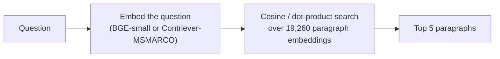
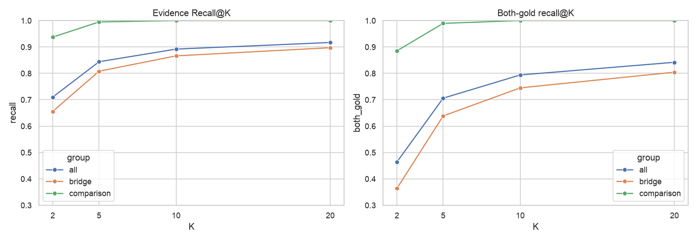
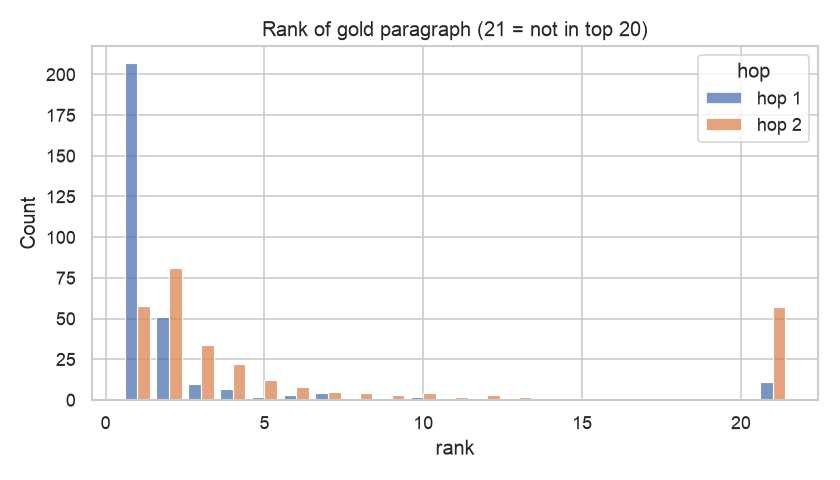
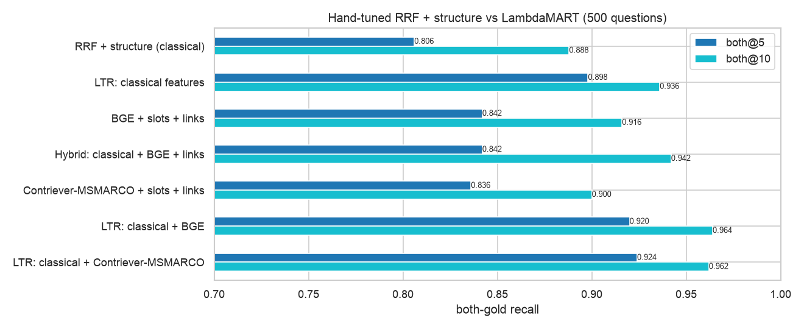
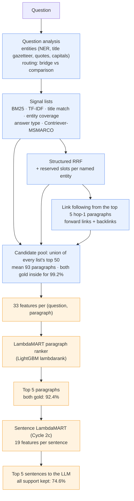
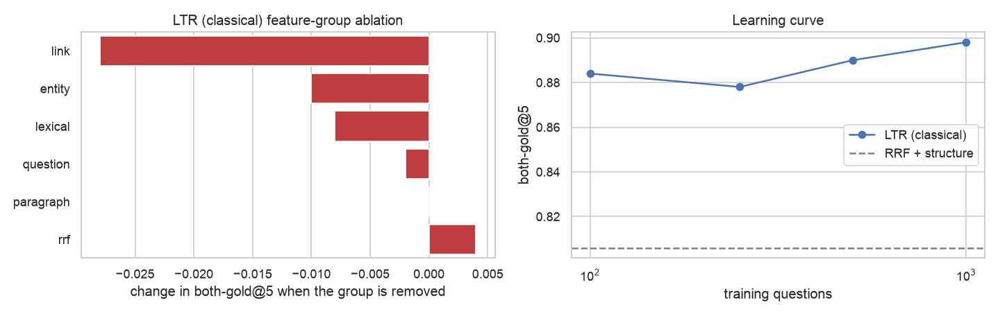
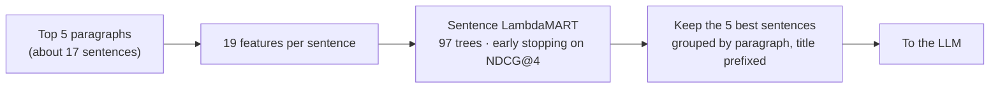

# Candidate selection and reranking (Cycles 1, 2 and 2c)

[← Overview](../README.md) · [EDA](01_eda.md) · **Candidates and reranking** · [Answer extraction](03_answer_extraction.md)

**Goal:** get **both** gold paragraphs (and then the right sentences) into the few slots the LLM reads. Retrieval-only numbers below use the 500 test questions, with no LLM involved; end-to-end answer quality is in [Answer extraction](03_answer_extraction.md). Sources: `notebooks/01_baseline_rag`, `02_classical_ranking`, `03_improved_rag`; code in `src/retrievers.py`, `src/classical.py`, `src/entities.py`, `src/fusion.py`, `src/ltr.py`, `src/sentences.py`.

**Two stages, both measured with recall, at different cutoffs:**

| Stage | Job | Metric |
|---|---|---|
| **Candidate generation** | Cheap signals build a wide pool (about 93 paragraphs); a gold paragraph missing here is lost for good | **Candidate recall**: both gold paragraphs in the pool |
| **Reranking** | A learned ranker orders the pool; the LLM reads the top 5 | **Both-gold recall@5** |
| **Sentence reranking** (Cycle 2c) | A second ranker keeps the 5 best sentences of the top 5 paragraphs | **All support kept**: every supporting sentence selected |

---

## Cycle 1: a single search

| Retriever | Both@5 | Hop 2 found @5 | Latency p50 | Trained on HotpotQA? |
|---|---|---|---|---|
| TF-IDF | 0.508 | – | ms | no |
| BM25 | 0.544 | 0.56 | ms | no |
| Contriever (unsupervised) | 0.470 | – | 33 ms | no |
| Contriever-MSMARCO | 0.602 | 0.56 | 33 ms | no |
| BGE-small-en-v1.5 | **0.706** | 0.69 | 17 ms | **yes** (train split) |

- **Choice of K = 5** (BGE): K = 2 → 5 raises both-gold recall from 46% to 71%; K = 5 → 10 adds only 9 points while doubling the prompt and adding distractors.
- **Comparison questions are nearly solved** (both@5 = 99%: both entities are named). **Bridge questions are the problem** (64%; still 80% at K = 20).
- **It's hop 2 that is missed,** as the EDA predicted: hop 1 is in the top 5 for 92% of bridge questions (median rank 1), hop 2 for only 69% (median rank 3).
- **BGE's lead is likely in-domain training:** BAAI lists the HotpotQA train split in BGE's fine-tuning data. Contriever-MSMARCO (MS MARCO only) is the clean dense model.

---

## Cycle 2: candidate generation + LambdaMART reranking

| Retriever | Both@2 | **Both@5** | Both@10 | Hop 2 @5 | Latency p50 | Trained on HotpotQA? |
|---|---|---|---|---|---|---|
| RRF over classical lists (plain / weighted) | – | 0.544 / 0.576 | – | – | 10 ms | no |
| Classical RRF + structure (routing, slots, links) | 0.472 | 0.806 | 0.888 | 0.81 | 10 ms | no |
| Contriever-MSMARCO + slots + links | 0.506 | 0.836 | 0.900 | 0.82 | 48 ms | no |
| BGE + slots + links | 0.540 | 0.842 | 0.916 | 0.86 | 27 ms | yes |
| **LambdaMART, classical features** (fallback) | 0.710 | 0.898 | 0.936 | 0.91 | 16 ms | no |
| LambdaMART + BGE | 0.756 | 0.920 | 0.964 | 0.92 | 35 ms | yes |
| **LambdaMART + Contriever-MSMARCO (selected)** | 0.744 | **0.924** | 0.962 | **0.93** | 59 ms | **no** |

**Main lessons:**
1. **Following links is the key multi-hop ingredient.** It adds 14–23 points to any first-stage retriever: read the top hop-1 paragraphs, then retrieve the paragraphs whose titles they mention.
2. **Merging lists with RRF alone barely beats BM25** (0.576 vs 0.544). Structure (question routing, reserved slots, links) brought the classical ranker to 0.806.
3. **A learned combiner beats hand-tuned rules by a wide margin:** LambdaMART goes from 0.806 to 0.898 on the same classical signals, winning 48 questions and losing 2 (sign test p ≈ 2e-12); both@2 rises from 0.47 to 0.71.
4. **BGE's advantage disappears** once links or LambdaMART are added (0.920 vs 0.924 for Contriever-MSMARCO), so the clean model is selected.

### The selected pipeline

Blue = candidate generation, orange = reranking.

**Why this one:**
- **Best evidence:** 0.924 both@5, 0.962 @10, hop 2 found 93% of the time.
- **Contamination-free:** Contriever-MSMARCO was trained on MS MARCO only; LambdaMART on 1,000 of our pool questions, separate from test.
- **Small latency cost:** 50–60 ms of retrieval.
- **Cheap to train:** about 1 s on a laptop; 100 training questions already give 0.884.

**Fallback:** LambdaMART with classical features only (0.898, 16 ms, no neural model, fully explainable).

### Signals (computed per question)

| Signal | What it measures |
|---|---|
| `bm25` | BM25 over stemmed unigrams (k1 = 1.2, b = 0.9) |
| `tfidf` | TF-IDF cosine similarity over unigrams and bigrams |
| `title` | Question entities matching a paragraph's **title**: exact 1.0, partial 0.7, fuzzy (character-trigram Dice ≥ 0.75), weighted by entity rarity (IDF) |
| `coverage` | Rarity-weighted share of question entities mentioned in the paragraph (first sentence 1.0, body 0.6) |
| `anstype` | The paragraph contains an entity of the expected answer type (a DATE for "what year"…) |
| `dense` | Contriever-MSMARCO dot-product similarity (frozen model, cached paragraph embeddings) |
| **Links** | A paragraph *links* to another if it mentions that paragraph's title or an alias (a title gazetteer: a classical stand-in for Wikipedia hyperlinks) |

**Question entities** come from spaCy NER, the title gazetteer (question n-grams equal to a corpus title), quoted strings and capitalized runs. **Routing:** a question is comparison-like when it has at least 2 named entities and a yes/no opener or a comparison cue ("older", "both", "same"…); this agrees with HotpotQA's labels 90% of the time.

### Candidate generation

Candidates are the **union of the top 50 of every ranked list**, duplicates removed:
- **Structured RRF ranking:** weighted RRF, $\text{RRF}(d)=\sum_i \lambda_i/(60+\text{rank}_i(d))$, with routing, reserved slots and link following.
- **Reserved slots:** the best paragraph for each named entity that exactly matches a title.
- **Each signal list:** BM25, TF-IDF, title, coverage, answer type, Contriever.
- **Forward-link candidates:** paragraphs mentioned by the top-5 hop-1 paragraphs. A candidate reached from the hop-1 paragraph at rank $r$ scores $0.5^{r-1}\big(1+\text{ov}(\text{linking sentence})+\text{ov}(\text{candidate's first sentence})\big)$, where ov is the summed IDF of the question words outside the entities that the text contains.
- **Backlink candidates:** paragraphs that mention a top-5 hop-1 paragraph.

**Result:** 54–171 candidates per question (mean 93); **candidate recall 99.2%**. The structured-RRF top 50 alone already holds 99% of the gold paragraphs; the other lists rarely add new golds. Their value is **information** (each list's scores and ranks become features) and realistic **hard negatives** for training (same-name look-alikes, near-miss BM25 matches).

### Features (33 per candidate)

| Group | Features |
|---|---|
| Question | `is_comparison`, `n_entities`, `n_named`, `question_len`, `has_anstype` |
| Lexical | `bm25`, `bm25_rel` (÷ max for the question), `bm25_rank`, `tfidf`, `tfidf_rel`, `tfidf_rank` |
| Dense | `dense`, `dense_gap` (question's best score − this score), `dense_rank` |
| Entity | `title_score`, `title_rank`, `is_slot`, `coverage`, `coverage_rank`, `anstype` |
| RRF | `bridge_rrf_rank`, `comparison_rrf_rank`, `structured_rank` |
| Link | `fwd_score`, `fwd_rank`, `fwd_parent_rank` (rank of the best hop-1 paragraph linking to it), `fwd_parent_count`, `back_score`, `back_rank`, `back_parent_rank` |
| Paragraph | `first_sentence_overlap`, `title_in_question`, `paragraph_len` |

A paragraph absent from a list gets a **missing** rank, which the trees handle natively.

### Reranking with LambdaMART

**The model:** LightGBM `LGBMRanker` with `objective="lambdarank"`, an ensemble of small gradient-boosted decision trees.

**Training:**
- Each question is a **group** of about 93 rows (candidates × features). Label 1 = gold paragraph, 0 = other.
- On each boosting round, for every (gold, non-gold) pair *within a question*, the gradient pushes the gold paragraph up, weighted by $|\Delta \text{NDCG@5}|$, the change in NDCG@5 if the two swapped. Errors near the top count most.
- Learning rate 0.05; rows and features subsampled at 80% per tree; up to 1,000 trees with **early stopping** on tuning-split NDCG@5 (patience 50).
- **Hyperparameters:** a 6-point grid (`num_leaves` ∈ {7, 15, 31} × `min_child_samples` ∈ {20, 50}) selected on tuning-split both@5. All six land within 0.006 of each other. The selected model has 15 leaves, minimum leaf size 50 and 245 trees.

**Scoring:** each candidate goes through every tree; **score = sum of the leaf values**; candidates are sorted and the top 5 go on. Scores only mean something *within* a question. Inference takes about 0.6 ms per question; the rest of the latency is feature extraction.

**How Contriever enters:** its top 50 is a candidate source; `dense`, `dense_gap` and `dense_rank` are features; and its list is fused into the structured RRF (weight 2), which shapes the hop-1 ranking and which links get followed. Contriever is never fine-tuned: the trees learn *when* to trust it.

### What the model relies on

| Analysis | Finding |
|---|---|
| **Ablation** (retrain without a feature group, classical model) | Links −0.028 (the only group it can't do without); entity −0.010; lexical −0.008; question −0.002; paragraph 0.000; RRF features +0.004 (the trees rebuild them from raw features) |
| **Gain importance** | `structured_rank` takes about 68% of the gain, yet the ablation shows it isn't needed: importance shows what the model split on, not what it needs |
| **Learning curve** | 100 training questions: 0.884; 1,000: 0.898. The gain comes from the model's flexibility, not data volume |
| **Failures fixed vs RRF + structure** | "Only a backlink" 11/16, "link outranked" 4/5, "hop 1 missed" 14/25, "no link in either direction" 8/27 |

### Leakage checks

A 9-point jump deserves suspicion:
- **No preference for "gold-looking" paragraphs:** 10% of LambdaMART's wrong top-5 picks are gold for *another* question, vs 14% for RRF (20% of the corpus is gold for some question).
- **Tuning and test agree:** 0.880 vs 0.898 for the classical model.
- **One mild corpus artifact:** gold paragraphs are shorter than HotpotQA's distractors. Length alone reaches 0.13 both@5 (random ordering: about 0.002), but removing the paragraph features doesn't change the score.

---

## Cycle 2c: sentence reranking

**Idea.** Even with both gold paragraphs retrieved, 3 of the 5 paragraphs are distractors, and inside the gold paragraphs only 1–2 sentences carry the answer. A second LambdaMART model, trained on HotpotQA's labeled supporting sentences (`supporting_facts`) with the same splits, picks the sentences most likely to be evidence.

**Features per sentence:**
- paragraph rank, and the sentence's position in its paragraph
- TF-IDF similarity and word overlap with the question
- overlap with the question words *outside* the entities
- share of question entities it mentions
- whether it contains the expected answer type
- whether it mentions the title of another top paragraph (the bridge sentence)
- whether its paragraph is linked from another top paragraph

Selection takes about 14 ms per question.

**How much evidence survives?** (500 test questions, no LLM; *all support kept* = every supporting sentence is selected; the ceiling, 92.4%, is the share whose supporting sentences are all inside the top 5 paragraphs.)

| Policy | Sentences | Words | All support kept | Supporting-sentence recall |
|---|---|---|---|---|
| Whole paragraphs | 16.7 | 356 | 92.4% | 96.0% |
| First sentence of each paragraph | 5 | 115 | 27.4% | 56.5% |
| TF-IDF top 5 | 5 | 102 | 35.6% | 66.1% |
| LTR top 5, at least 1 per paragraph | 5 | 122 | 48.0% | 72.8% |
| **LTR top 5 (selected)** | 5 | 113 | **74.6%** | **86.5%** |
| LTR top 8 | 8 | 178 | 83.2% | 91.3% |

- **The learned ranker keeps twice as much evidence as TF-IDF** at the same budget.
- Most important features: the paragraph's rank (53% of the gain), then overlap with the non-entity question words, then mentioning another top paragraph's title.
- **Selector recall is the main lever left:** when all supporting sentences are kept, the LLM scores EM 0.576 on them, close to the oracle (see [Answer extraction](03_answer_extraction.md#cycle-2c-sentences-instead-of-paragraphs)).

---

## Rejected retrieval technologies

| Technology | Result | Reason rejected |
|---|---|---|
| **Plain / weighted RRF** as the final ranker | 0.544 / 0.576 | Ranks only, no confidence or interactions; barely beats BM25 |
| **Always-on backlinks** | Coverage 65% → 84%, but both@5 unchanged or worse | Backlink candidates push correct forward links out of the top 5; only a learned model can decide when to trust them |
| **Stemming / lemmatization for title matching** | +0.7 points of link coverage | Word-level matching tops out at about 70%; the misses are paraphrases, not inflections |
| **Word-vector (GloVe) soft title matching** | About +2% coverage | Noisy matches, a 480 MB dependency |
| **Title aliases** (comma head, acronyms) | +0.002 when removed | Rarely triggered, and some added links are wrong |
| **BGE as the main retriever** | Best single search (0.706) | Trained on the HotpotQA train split: an unfair in-domain advantage (BGE-large has the same training data) |
| **Unsupervised Contriever** | 0.470 | Weaker than BM25 without MS MARCO fine-tuning |
| **Cross-encoder reranker** (a Cycle 1 hypothesis) | Not tested | Deprioritized once LambdaMART reached 0.924 of a 0.992 candidate ceiling in under 60 ms. A cross-encoder scores one paragraph at a time, so it can't use the hop-1 → hop-2 links that drive the gains; it remains an untested option on top of the LambdaMART features |
| **TF-IDF sentence selection** | All support kept 36% (learned: 75%) | Misses bridge sentences, which share few words with the question |
| **"At least 1 sentence per paragraph"** | All support kept 48% vs 75% | Spends the budget on distractor paragraphs; gold ones often need 2 sentences |
| **Top 8 sentences** | EM 0.487 vs 0.503 for top 5, with 36% more tokens | More evidence, but also more noise |

## Retrieval caveats

- **Closed corpus.** The title gazetteer (our stand-in for hyperlinks) would find many spurious links against full Wikipedia (about 5M titles); in an open setting, use real hyperlinks.
- **Supervision.** LambdaMART learns from gold labels on 1,000 HotpotQA questions: the same *kind* of in-domain supervision flagged for BGE, but small, visible, and on separate questions.
- **Sentence labels.** The sentence ranker learns from `supporting_facts`, which most real corpora lack; one would need weak labels (sentences containing the answer) or an LLM to label a sample.
- **Shorter-paragraph bias.** Part of the token and latency saving comes from LTR preferring shorter paragraphs, a corpus artifact.
- **Noise level.** On 500 questions one question = 0.2 points; differences under about 2 points are noise.
- **Hybrid RRF weights** were tuned with BGE and reused for Contriever; LambdaMART can reweight the raw features, so the effect is small.
- **One test-set decision:** the final variant (Contriever over BGE) was chosen after seeing test numbers, for BGE's contamination, not its 0.004 gap.
