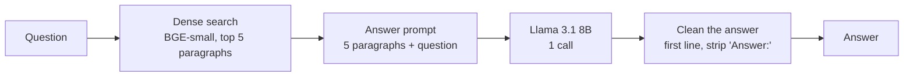
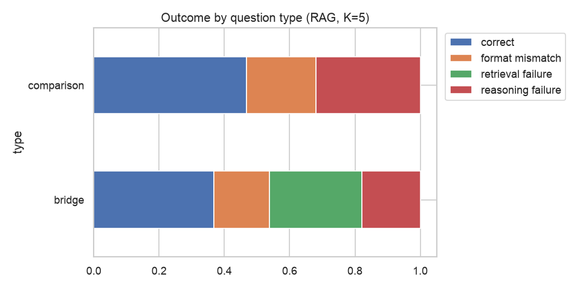
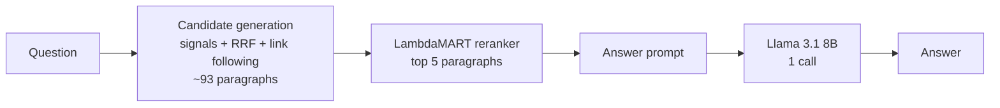
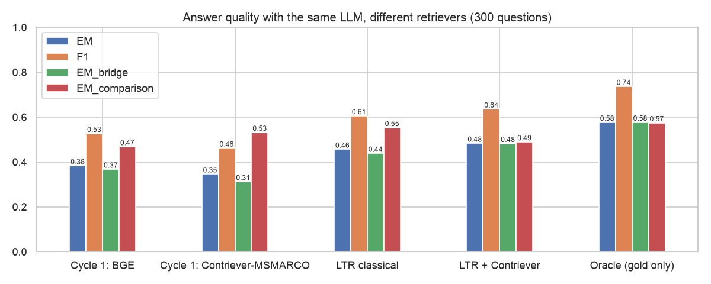
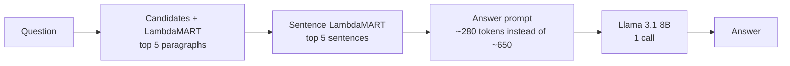
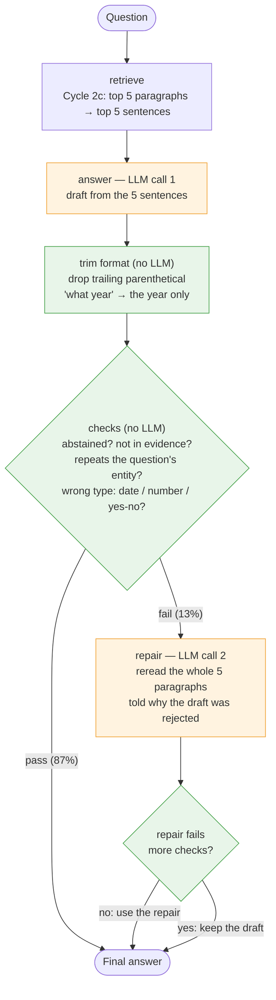
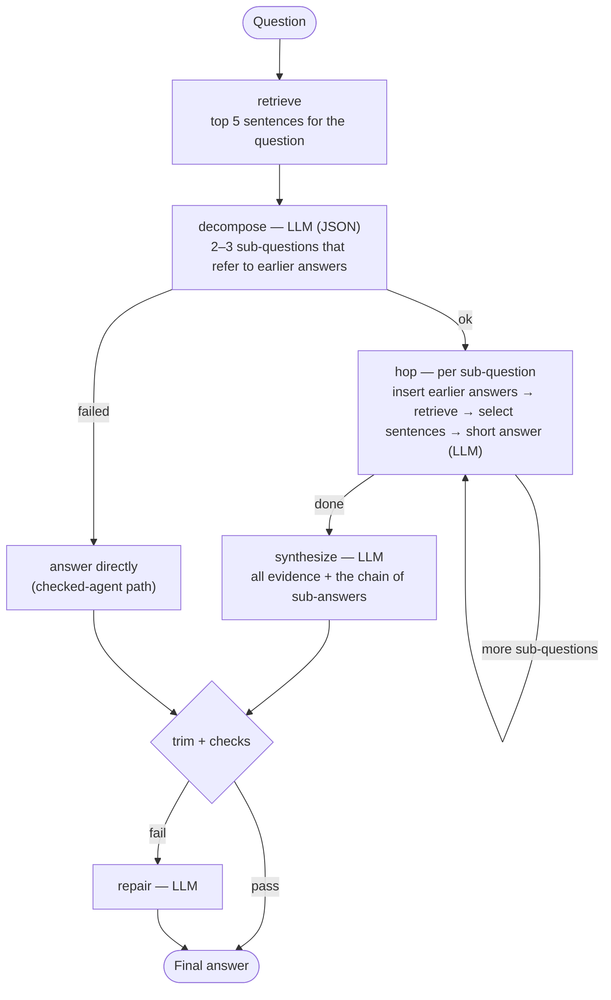
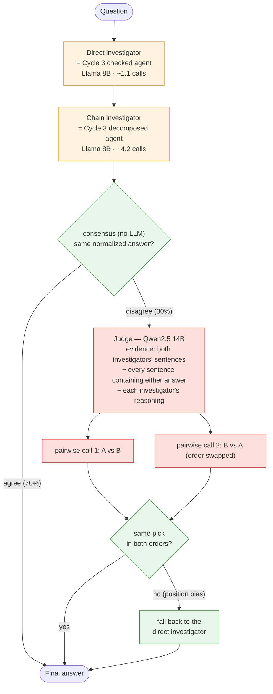

# Answer extraction methods (Cycles 1–4)

[← Overview](../README.md) · [EDA](01_eda.md) · [Candidates and reranking](02_candidates_and_reranking.md) · **Answer extraction**

**Goal:** turn the retrieved evidence into a short, correct, grounded answer. Every run uses Llama 3.1 8B (Ollama, temperature 0) on the first 300 test questions unless stated; design decisions for Cycles 3–4 were made on 300 tuning-split questions ("dev"). Code: `src/rag.py`, `src/agent.py`, `src/team.py`.

**Latency note.** Latencies inside the per-cycle tables come from the main runs and are comparable only within one table. The [overview's final table](../README.md#5-final-comparison) uses the clean single-session benchmark.

**Error classes used throughout:** a wrong answer is a **retrieval failure** if a gold paragraph was missing from what the LLM read, and a **reasoning failure** if both were there.

**The answer prompt** (all cycles):
```text
System: You answer multi-hop questions using only the evidence paragraphs provided. Reply with the answer only:
        a short span (usually 1-5 words), copied from the evidence when possible, or 'yes'/'no' for yes/no
        questions. No explanation and no full sentence.
User:   Evidence:
        [1] <title>: <text>
        ...
        Question: <question>
        Answer:
```

---

## Cycle 1: basic RAG



| Setup | EM | F1 | Both gold in context | Unsupported | Prompt tokens | Cost / 1k | Latency p50 / p95 |
|---|---|---|---|---|---|---|---|
| Closed book (100 questions) | 0.24 | 0.33 | – | – | 99 | $0.005 | 0.6 s / 1.0 s |
| **BGE-small top 5 + Llama** | **0.383** | **0.527** | 68% | 18.7% | 716 | $0.036 | 4.7 s / 8.4 s* |
| Contriever-MSMARCO top 5 + Llama (clean) | 0.347 | 0.462 | 57% | 10.7% | 719 | $0.036 | 3.6 s / 5.5 s |

\*Earlier session, slower machine state.

- **Why RAG and not the LLM alone:** on the same 100 questions retrieval raises EM from 0.24 to 0.37 and F1 from 0.33 to 0.56, all of it on bridge questions (EM 0.20 → 0.35). Closed book confidently invents facts ("1880" for Moscow State University; correct: 1755).
- **Comparison questions gain nothing** (EM 0.50 both ways): retrieval finds both paragraphs 99% of the time, so the limit is the 8B model's ability to compare.
- **Answers become traceable:** 81% appear word-for-word in the evidence. About half of the 19% unsupported are abstentions ("no information provided"), and 25 of those 28 happen when a gold paragraph really was missing.
- **32% of questions still miss a gold paragraph**, mostly hop 2, which a single search can't reach.



---

## Cycle 2: the same RAG with better retrieval

Only the retriever changes: the LambdaMART reranker over link-aware candidates ([details](02_candidates_and_reranking.md#cycle-2-candidate-generation--lambdamart-reranking)). The **oracle** gives the LLM exactly the 2 gold paragraphs: not a real system, but the ceiling of this LLM with perfect retrieval.



| Run | EM | F1 | Both gold in context | Retrieval / reasoning failures | Unsupported | Prompt tokens | Latency p50 / p95 | Cost / 1k |
|---|---|---|---|---|---|---|---|---|
| Cycle 1: BGE | 0.383 | 0.527 | 68% | 24% / 20% | 18.7% | 716 | (earlier session) | $0.036 |
| Cycle 1: Contriever-MSMARCO | 0.347 | 0.462 | 57% | 33% / 20% | 10.7% | 719 | 3.6 s / 5.5 s | $0.036 |
| LTR classical | 0.457 | 0.606 | 89% | 8% / 28% | 5.3% | 646 | 3.3 s / 4.7 s | $0.033 |
| **LTR + Contriever (selected)** | **0.483** | **0.636** | **91%** | **5% / 29%** | **6.0%** | 647 | 3.9 s / 5.7 s | $0.033 |
| Oracle (gold only) | 0.577 | 0.736 | 100% | 0% / 22% | 3.3% | 307 | 1.3 s / 2.0 s | $0.016 |

- **+10 EM points over BGE from retrieval alone,** significant: 43 questions won vs 13 lost (p < 0.001), 95% CI [+0.05, +0.15]. The gain is on bridge questions (EM 0.37 → 0.48).
- **+13.7 points over the clean baseline** with the same dense model (Contriever-MSMARCO alone 0.347 → inside LTR 0.483; 56 won vs 15 lost).
- **Half of the gap to perfect retrieval is closed** (0.383 → 0.483 of 0.577).
- **The bottleneck moved from retrieval to the LLM:** retrieval failures 24% → 5%, reasoning failures 20% → 29%. Even with perfect retrieval the 8B model misses 42% by EM.
- **Distractors still hurt:** with full evidence, 5 paragraphs give EM 0.50 vs 0.56 with only the 2 gold ones.
- **More grounded:** unsupported answers 18.7% → 6.0%; abstentions 8.3% → 1.3%.



---

## Cycle 2c: sentences instead of paragraphs

The sentence reranker ([details](02_candidates_and_reranking.md#cycle-2c-sentence-reranking)) keeps the 5 best sentences of the top 5 paragraphs; only those reach the LLM.



| Run | EM | F1 | Unsupported | Prompt tokens | Latency p50 / p95 | Cost / 1k | Won / lost |
|---|---|---|---|---|---|---|---|
| LTR + Contriever, 5 paragraphs | 0.483 | 0.636 | 6.0% | 647 | 3.9 s / 5.7 s | $0.033 | – |
| LTR + Contriever, top 8 sentences | 0.487 | 0.643 | 4.0% | 382 | 2.3 s / 3.1 s | $0.020 | 15 / 14 vs paragraphs |
| **LTR + Contriever, top 5 sentences** | **0.503** | **0.654** | 6.0% | **281** | **1.7 s / 2.3 s** | **$0.014** | 32 / 26 vs paragraphs (p = 0.51) |
| Oracle: gold paragraphs | 0.577 | 0.736 | 3.3% | 307 | 1.3 s / 2.0 s | $0.016 | – |
| Oracle: gold supporting sentences | 0.593 | 0.759 | 4.3% | 197 | 1.0 s / 1.5 s | $0.010 | 14 / 9 vs gold paragraphs |

- **Same quality at less than half the cost and latency:** 57% fewer prompt tokens, p50/p95 down 57%/60%. The +2 EM points are not significant, so the honest claim is "no loss, twice as fast."
- **Less text helps an 8B model:** given perfect sentences, Llama scores 0.593, slightly above the 0.577 it gets from the gold paragraphs.
- **Two effects cancel out:**

  | Questions | Count | EM, top 5 sentences | EM, 5 paragraphs |
  |---|---|---|---|
  | All supporting sentences kept | 224 | **0.576** | 0.478 |
  | Some supporting sentence dropped | 76 | 0.289 | 0.500 |

  Removing distractor text is worth about +10 EM points; dropping evidence costs about 21. **Selector recall is now the lever.**
- Retrieval failures rise from 5% to 12% (a gold paragraph with no selected sentence); reasoning failures drop from 29% to 20%.

---

## Cycle 3: a single agent (LangGraph)

**Where the errors were.** With good retrieval, the remaining errors are the LLM's: the wrong hop or answer type ("What *county*…" answered with a town; "what company *in addition to* The Home Depot?" answered "The Home Depot") and format mismatches ("May 1, 1989" for "what year"). So Cycle 3 targets reasoning and format, not retrieval.

**Design: the code fixes the control flow; the LLM does one narrow task per node.** Both agents are LangGraph graphs (state = a typed dict, branches = conditional edges). An 8B model is unreliable at choosing its own tools and when to stop (free-form ReAct), so the path is fixed and every step is measured.

### The checked agent (selected)



Orange = LLM call, green = deterministic code.

### The decomposed agent (used as the chain investigator in Cycle 4)



### Results

| Step (dev, 300 questions) | EM | Won / lost vs previous step | Extra cost |
|---|---|---|---|
| Cycle 2c draft | 0.527 | – | – |
| + format trim | 0.553 | 8 / 0 | none |
| + checks and repair | **0.583** | 10 / 1 | a 2nd call on 13% of questions |
| Decomposed agent instead | 0.593 | 27 / 24 vs checked (noise) | 4.2 calls, 4× latency |

- **The checks are precise but catch few errors.** They flag 13% of answers, of which only 13% were correct (59% for the rest). Repair fixes abstentions best (4 of 10: rereading whole paragraphs recovers dropped evidence).
- **Decomposition fixes retrieval but hurts reasoning.** Retrieval failures halve (28 → 14) because each hop retrieves separately, but a wrong sub-answer misleads the final call (reasoning failures 44 → 61). It hinges on hop 1:

  | Bridge questions (dev) | Questions | EM, decomposed | EM, checked |
  |---|---|---|---|
  | Hop-1 answer = the true bridge entity | 82 | 0.634 | 0.561 |
  | Hop-1 answer wrong | 96 | 0.438 | 0.417 |

  The synthesis call is essential: using the hop-2 answer directly gets EM 0.28 (the rewritten sub-question drifts from the original).
- **Test:** checked agent **0.537** vs 0.503 for Cycle 2c (13 won / 3 lost, p = 0.02) at 1.1 calls and the same median latency; unsupported answers halve (6.0% → 3.0%). Decomposed 0.533, with the best evidence of all systems (both gold paragraphs in context 94%).

---

## Cycle 4: a multi-agent investigation team (LangGraph)

**Motivation (dev).** The two Cycle 3 agents fail on different questions. They agree on 70% (EM 0.72 there) and disagree on 30% (EM 0.26–0.30 each). Picking the right one every time would give EM 0.673. A no-LLM judge (prefer the answer passing more checks) separates only 11 of 91 disagreements, so the judge has to read the evidence.



On this 17 GB laptop Llama 8B (5.9 GB) and Qwen 14B (10.4 GB) don't fit in GPU memory together: Ollama returns blank answers. The deployed team unloads one model before calling the other (about 8.6 s of swapping per disagreement), or judges in batches after the investigators finish.

**Controls**, to tell whether the *team* adds value:
- *Self-consistency:* the checked agent with 5 answers sampled at temperature 0.7 and a majority vote (more calls, no roles).
- *Bigger model alone:* the checked agent with Qwen2.5 14B as the answerer.

| System (dev, 300 questions) | EM | Won / lost vs checked (Llama) | Notes |
|---|---|---|---|
| Checked agent, Llama 8B | 0.583 | – | |
| Self-consistency, 5 samples | 0.587 | 4 / 3 | unanimous votes (48%): EM 0.70 |
| Team, Llama 8B judge (pairwise) | 0.600 | 6 / 1 | picks the first-shown answer in both orders in 35 of 91 cases |
| Team, Llama 8B judge (pointwise) | 0.600 | 6 / 1 | calls both answers "supported" in 36 of 91 |
| **Team, Qwen 14B judge (pairwise)** | **0.627** | 16 / 3 (p = 0.004) | position bias down to 22 cases |
| Checked agent, Qwen 14B alone | 0.583 | 25 / 25 | |

| System (test, 300 questions) | EM | LLM calls | Cost / 1k | Latency p50 / p95 (clean benchmark) |
|---|---|---|---|---|
| Checked agent, Llama 8B | 0.537 | 1.11 | $0.018 | 1.6 s / 4.1 s |
| Self-consistency, 5 samples | 0.527 | 5.11 | $0.076 | 2.3 s / 4.0 s |
| Checked agent, Qwen 14B alone | 0.573 | 1.16 | $0.148 | 2.7 s / 8.0 s |
| Team, 8B judge | 0.563 | 5.96 | $0.115 | 7.0 s / 13.6 s |
| **Team, 14B judge** | **0.580** | 5.96 | $0.254 | 9.5 s / 32.6 s |

- **An 8B judge is too weak:** strong position bias (pairwise) or leniency (pointwise).
- **A 14B judge works**, and is only needed on the 30% of disagreements: the team beats the checked agent (16 / 3, p = 0.004) and self-consistency (24 / 8, p = 0.007) on test. The judge is right on 41 of the 55 test disagreements where exactly one investigator is right (always taking the direct answer: 28).
- **But it doesn't beat the bigger model used alone:** team vs Qwen alone is 33 / 20 on dev and 26 / 24 on test (pooled p ≈ 0.17), and Qwen alone needs 1.2 calls instead of 6, no model swapping, and a third of the median latency.
- **More calls without diversity don't help:** self-consistency's 5 samples share the same mistakes.

---

## Rejected answer-extraction technologies

| Technology | Result | Reason rejected |
|---|---|---|
| **Free-form ReAct agent** (the LLM picks tools and when to stop) | Not built | An 8B model is unreliable at planning tool calls; a fixed LangGraph flow is predictable, measurable per step, and debuggable |
| **Question decomposition as the main agent** | Dev 0.593 vs 0.583 (27 / 24), test 0.533 vs 0.537 | 4× the calls and latency for no gain: a wrong hop-1 answer propagates. Kept as the second investigator in Cycle 4 |
| **Using the last hop's answer directly** (no synthesis call) | EM 0.28 | The rewritten sub-question drifts from the original question |
| **Self-consistency** (5 samples, majority vote) | Test 0.527 vs 0.537 | 4.6× the calls; repeated samples share the same mistakes |
| **8B judge** in the team | Dev 0.600 (n.s.), test 0.563 | Position bias (pairwise) and leniency (pointwise): a judge must be stronger than the investigators |
| **Rule-based judge** (prefer the answer passing more checks) | Separates 11 of 91 disagreements | The checks only catch answers that *look* wrong |

## Answer-extraction caveats

- **Prompts were developed with Llama.** The Qwen 14B runs reuse them; a model-specific prompt could change its numbers.
- **EM is strict on wording.** Gold answers sometimes use full names ("Dara Grace Torres"); F1 is reported alongside.
- **300 questions** give ±2.8 EM points of standard error: differences among the top systems (0.537–0.580) need the per-question sign tests.
- **Dev overlaps the tuning split** (`pool[1500:1800]` was also used for LambdaMART early stopping): no test leakage, but not fully fresh for the rankers.
