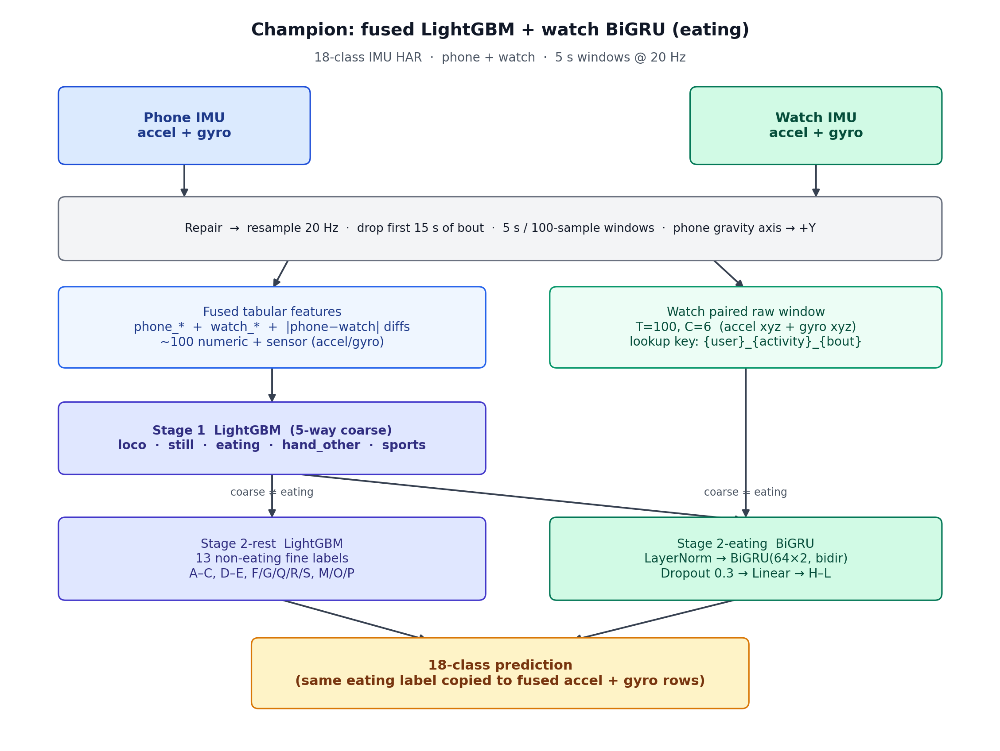
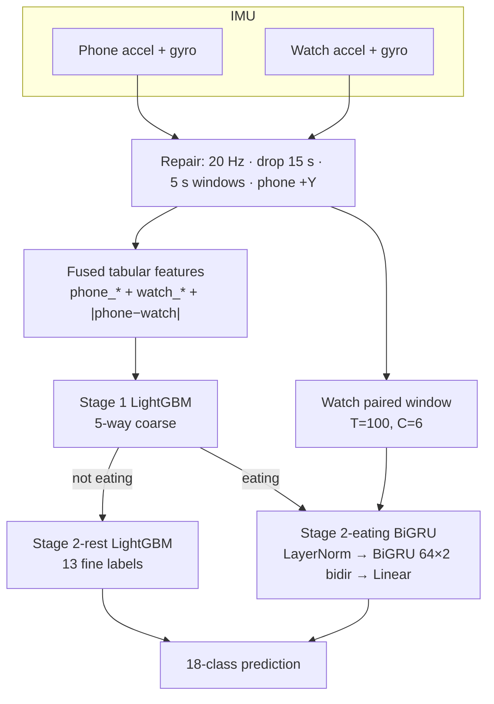
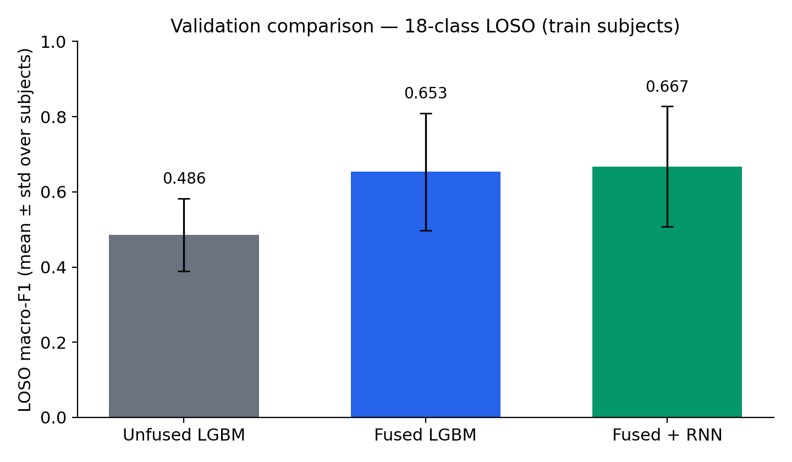
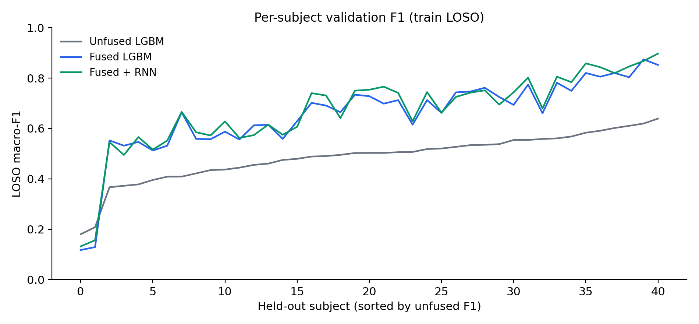
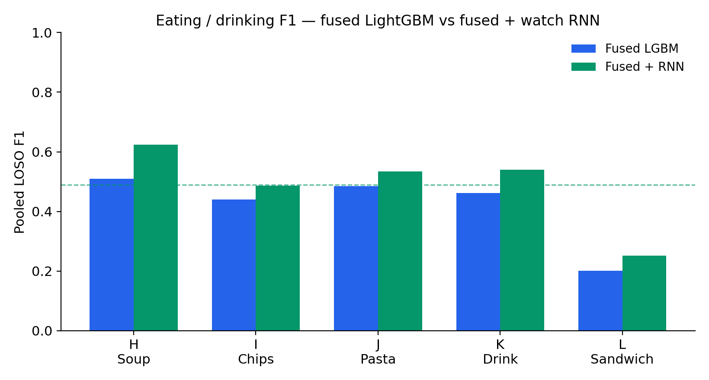

# Phone + Watch IMU Activity Recognition

## Business logic and KPIs

**Product:** a phone + watch activity / meal / workout logger. The user does not
label 5 s windows; the model fills the diary from IMU. Phone captures body and
locomotion; watch captures wrist motion (eating, typing, sports). The system
must work for a **new person** without per-customer retraining.

These are the intended **business** outcomes. model metrics below are proxies only.

| Business KPI | Why it matters | Model proxy we actually have |
| --- | --- | --- |
| Share of meals/snacks auto-logged without user tap | Nutrition feature only works if eating is detected | Eating H–L F1; sandwich (L) F1 |
| False “sedentary” alerts while the person is eating, typing, or standing | Bad alerts → users mute or churn | Sit/stand vs eating/hand confusion; still-group F1 |
| Workout minutes credited correctly (walk, jog, sports) | Trust in activity totals / gamification | `loco` + `sports` F1 |
| Works on a **new person** out of the box | Cannot retrain per customer | Subject-disjoint LOSO / frozen-test macro-F1 |
| Support load from “wrong activity” tickets | Ops cost | Per-subject error rate, especially hard users |

**Champion (technical):** hierarchical fused LightGBM with a watch BiGRU eating
specialist. Model choice used leave-one-subject-out (LOSO) on the **train users
only**. The frozen test users were scored **once**.

| Split | Users | Fused windows | Macro-F1 |
| --- | ---: | ---: | ---: |
| Train LOSO (41 subjects) | 41 | 46,720 | **0.668 ± 0.160** |
| Frozen test (one-shot) | 10 | 11,168 | **0.638** |

---

## Protocol

- **Dataset:** 51 subjects, 18 activities (A–S; N unused). Phone + watch, accel + gyro.
- **Windows:** 5 s, non-overlapping, resampled to 20 Hz (100 samples). First 15 s of each bout dropped. Phone gravity-ish axis mapped to +Y; watch axes unchanged.
- **Train / test:** subject-disjoint. Test users were frozen until the final champion eval:

```
1606, 1607, 1618, 1626, 1629, 1639, 1640, 1641, 1643, 1646
```

- **Validation:** LOSO on the 41 train subjects. Hyperparameters (LightGBM, RNN early-stopping) were chosen on train folds / inner subject splits only.
- **Model metrics (proxies for the KPIs above):** 18-class macro-F1 (primary for selection), accuracy, coarse 5-way F1, eating H–L F1, per-activity F1, per-subject F1.

**Activities**

| Code | Name | Coarse group |
| --- | --- | --- |
| A B C | Walking, Jogging, Stairs | `loco` |
| D E | Sitting, Standing | `still` |
| H I J K L | Soup, Chips, Pasta, Drink, Sandwich | `eating` |
| F G Q R S | Typing, Brushing Teeth, Writing, Clapping, Folding Clothes | `hand_other` |
| M O P | Kicking Soccer Ball, Playing Catch, Dribbling Basketball | `sports` |

---

## Champion architecture (fused + RNN)

Phone and watch streams are repaired, windowed, and fused into one tabular row
per `(user, activity, sensor, bout)`. Stage 1 LightGBM predicts a 5-way coarse
group. Non-eating windows go to a 13-class LightGBM. Eating windows go to a
watch-only BiGRU on paired accel+gyro `(T=100, C=6)`. The eating label is copied
to both fused accel and gyro rows. If no watch pair exists, the fallback eating
class is `H` (0 fallbacks on the test set).





**Eating BiGRU:** LayerNorm on 6 channels → 2-layer bidirectional GRU (hidden 64,
dropout 0.3) → last timestep → Linear to `{H, I, J, K, L}`. Trained with Adam
(`lr=1e-3`, weight decay `1e-4`), batch 256, max 40 epochs, early-stop patience 6
on an inner subject-holdout F1.

---

## Validation results (train LOSO only)

All numbers below are **train-subject LOSO**. The test split was not used here.

### Overall comparison

Fusion of phone + watch is the large gain (about +0.17 macro-F1). The hierarchical
watch RNN adds a smaller eating-specific gain (about +0.014 overall, ~+0.07 pooled
eating F1 vs fused LightGBM).

| Model | Accuracy | Macro-F1 | Eating H–L F1 | Coarse F1 |
| --- | ---: | ---: | ---: | ---: |
| Unfused LightGBM (repaired + mag-deltas) | 0.494 ± 0.097 | 0.486 ± 0.097 | — | — |
| Fused LightGBM (`fused_tuned`) | 0.673 ± 0.144 | 0.654 ± 0.156 | ~0.42 pooled | — |
| Hierarchical fused LightGBM (watch-prefer eating) | 0.676 ± 0.144 | 0.659 ± 0.157 | 0.460 ± 0.160 | 0.841 ± 0.145 |
| **Fused + RNN (champion)** | **0.685 ± 0.149** | **0.668 ± 0.160** | **0.490 ± 0.183** | **0.841 ± 0.145** |





Subject variance is large (some held-out users drop below 0.20 F1). Fusion helps
almost every subject; the RNN tracks fused LightGBM and is slightly higher on
many folds.

### Eating / drinking (the weak group)

Pooled LOSO F1 on H–L. Sandwich (L) stays the hardest class.

| Activity | Fused LGBM | Hier. LGBM | **Fused + RNN** |
| --- | ---: | ---: | ---: |
| H Soup | 0.510 | 0.528 | **0.624** |
| I Chips | 0.441 | 0.465 | **0.486** |
| J Pasta | 0.486 | 0.492 | **0.535** |
| K Drink | 0.462 | 0.518 | **0.540** |
| L Sandwich | 0.201 | **0.255** | 0.252 |
| Mean (pooled) | 0.420 | 0.452 | **0.487** |

Watch-only BiGRU on the eating subset alone (not the 18-class pipeline) reached
LOSO macro-F1 **0.517 ± 0.173**, with sandwich F1 0.316.



### Champion per-activity F1 (train LOSO, pooled)

| Code | Activity | F1 | Support |
| --- | --- | ---: | ---: |
| A | Walking | 0.854 | 2624 |
| B | Jogging | 0.941 | 2496 |
| C | Stairs | 0.761 | 2528 |
| D | Sitting | 0.546 | 2624 |
| E | Standing | 0.626 | 2624 |
| F | Typing | 0.700 | 2496 |
| G | Brushing Teeth | 0.756 | 2624 |
| H | Eating Soup | 0.624 | 2592 |
| I | Eating Chips | 0.486 | 2624 |
| J | Eating Pasta | 0.535 | 2560 |
| K | Drinking from Cup | 0.540 | 2624 |
| L | Eating Sandwich | 0.252 | 2592 |
| M | Kicking Soccer Ball | 0.775 | 2624 |
| O | Playing Catch | 0.824 | 2592 |
| P | Dribbling Basketball | 0.812 | 2624 |
| Q | Writing | 0.707 | 2624 |
| R | Clapping | 0.841 | 2624 |
| S | Folding Clothes | 0.811 | 2624 |

Locomotion, sports, and most hand activities are strong. Still poses (sit/stand)
and eating — especially sandwich — remain the failure modes.

### Other models tried (train only)

These lost to fused LightGBM on comparable subject-grouped CV. None of them was
scored on the frozen test set.

| Model | Protocol | Macro-F1 |
| --- | --- | ---: |
| Logistic regression (extended features) | LOSO | 0.345 ± 0.058 |
| kNN (extended features) | LOSO | 0.383 ± 0.067 |
| Frozen LIMU-BERT + LightGBM | LOSO | 0.338 ± 0.088 |
| LIMU-BERT finetune | LOSO | 0.254 ± 0.079 |
| rWISDM DCNN (18-class) | 5-fold GroupKFold | 0.477 ± 0.036 |
| Activity transformer (focal, 8-ch) | LOSO (3 folds only) | ~0.46 |

---

## Frozen test set (champion only)

Champion retrained on **all 41 train users**, then scored once on the 10 test
users. Test was unused for model selection.

| Metric | Test |
| --- | ---: |
| Windows / users | 11,168 / 10 |
| Accuracy | 0.641 |
| **Macro-F1** | **0.638** |
| Micro-F1 | 0.641 |
| Weighted-F1 | 0.643 |
| Coarse 5-way F1 | 0.848 |
| Eating H–L F1 | 0.398 |
| Watch-pair fallbacks | 0 |
| RNN inner-val F1 / epochs | 0.474 / 23 (early stop) |

Generalization vs train LOSO: overall F1 0.668 → **0.638**. Coarse routing stays
strong (0.841 → 0.848). Eating F1 drops (0.490 → 0.398), driven by chips and
sandwich.

### Test per-activity F1

| Code | Activity | F1 | Support |
| --- | --- | ---: | ---: |
| A | Walking | 0.838 | 640 |
| B | Jogging | 0.942 | 640 |
| C | Stairs | 0.781 | 608 |
| D | Sitting | 0.493 | 640 |
| E | Standing | 0.658 | 608 |
| F | Typing | 0.704 | 640 |
| G | Brushing Teeth | 0.673 | 640 |
| H | Eating Soup | 0.484 | 640 |
| I | Eating Chips | 0.293 | 576 |
| J | Eating Pasta | 0.489 | 576 |
| K | Drinking from Cup | 0.459 | 640 |
| L | Eating Sandwich | 0.129 | 576 |
| M | Kicking Soccer Ball | 0.852 | 640 |
| O | Playing Catch | 0.774 | 576 |
| P | Dribbling Basketball | 0.795 | 640 |
| Q | Writing | 0.693 | 608 |
| R | Clapping | 0.685 | 640 |
| S | Folding Clothes | 0.749 | 640 |

### Test per-subject F1

| User | Windows | Accuracy | Macro-F1 |
| ---: | ---: | ---: | ---: |
| 1606 | 1152 | 0.672 | 0.661 |
| 1607 | 1088 | 0.572 | 0.528 |
| 1618 | 1088 | 0.705 | 0.667 |
| 1626 | 1152 | 0.773 | 0.775 |
| 1629 | 1152 | 0.671 | 0.650 |
| 1639 | 1088 | 0.432 | 0.411 |
| 1640 | 1088 | 0.415 | 0.383 |
| 1641 | 1120 | 0.681 | 0.689 |
| 1643 | 1088 | 0.824 | 0.794 |
| 1646 | 1152 | 0.655 | 0.645 |
| Mean ± std | — | 0.640 ± 0.133 | 0.620 ± 0.139 |

Users 1639 and 1640 are the hard test subjects (macro-F1 0.41 / 0.38), consistent
with high LOSO subject variance.
---

## What worked / what did not

- **Phone+watch fusion** is the main lift. Unfused rows treat devices as separate
  examples and cannot use complementary body vs wrist motion.
- **Coarse routing is reliable** (~0.84–0.85 F1). Most remaining error is
  *within* eating and sit vs stand.
- **Watch BiGRU** improves soup / pasta / drink / chips over tabular eating
  specialists. Sandwich stays near chance-to-weak (test F1 0.129): similar
  wrist kinematics to other eating, little unique spectral signature.
- End-to-end deep models (transformer, LIMU-BERT, DCNN) did not beat fused
  LightGBM at this window size and sample count, with the compute budget used.
- macOS: LightGBM + PyTorch both ship OpenMP. Use `n_jobs=1`,
  `OMP_NUM_THREADS=1`, and `KMP_DUPLICATE_LIB_OK=TRUE` before importing both
  (see `hier_eating_rnn.py`).

**Open issues:** sandwich vs other eating; sit vs stand; two very hard subjects
on both LOSO and test. Possible next steps (not run): late fusion of watch RNN
logits with LightGBM, longer windows / bout-level voting, sandwich-specific
features (bite/pause cadence).

