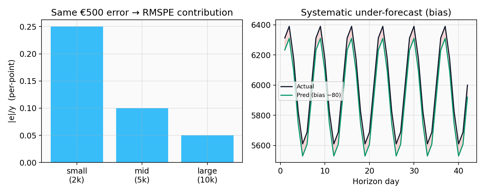
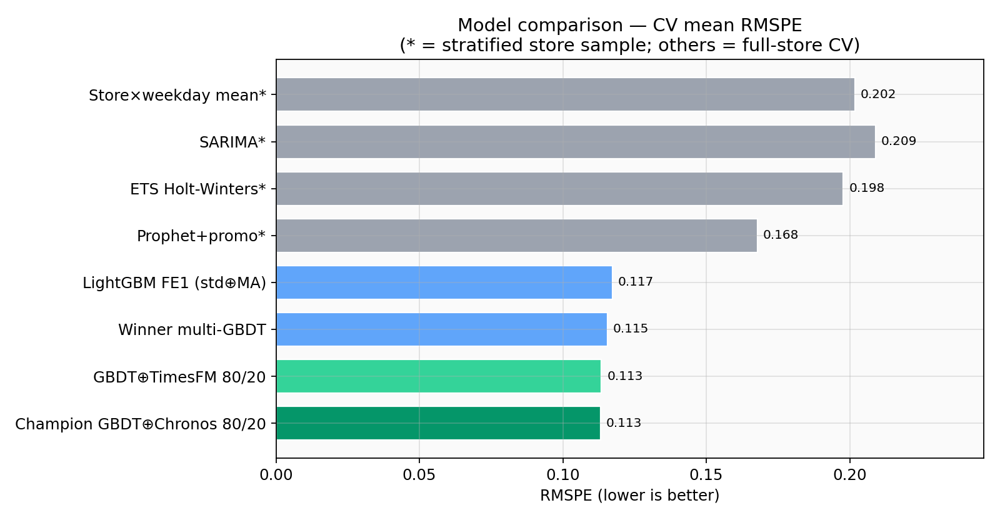
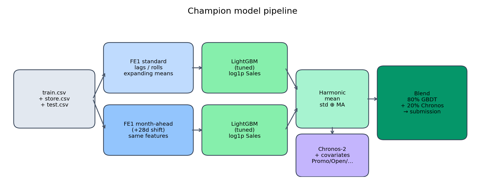
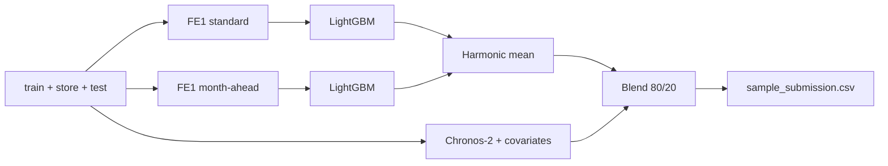
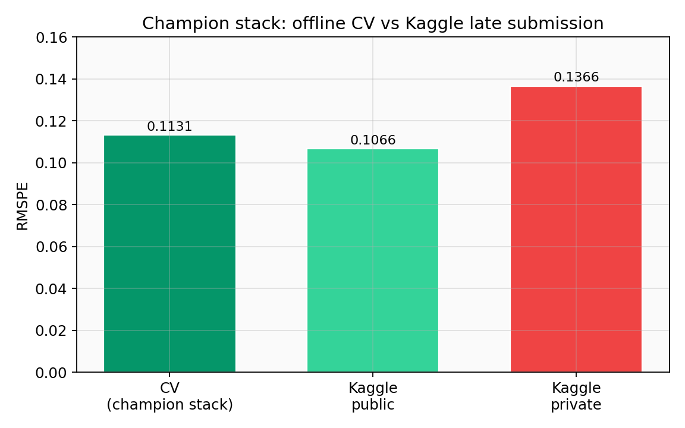
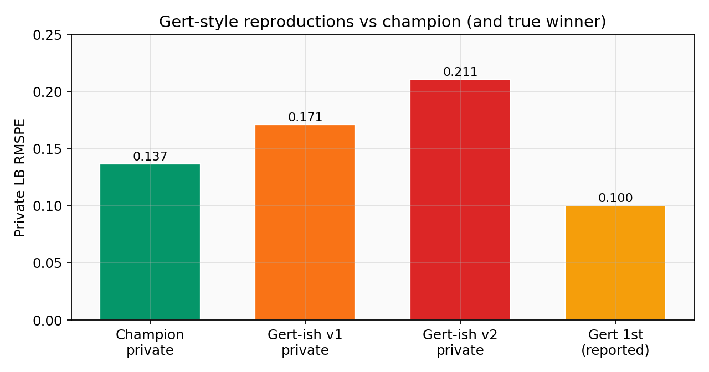

# Rossmann Store Sales — Project Summary

Forecasting daily store sales for Rossmann (Kaggle *Rossmann Store Sales*).  
This README summarizes business framing, metrics, the model ladder, the **champion** stack, why we trail the 2015 winner, and next steps.

---

## 1. Business logic & KPIs

Rossmann needs **6-week-ahead daily sales forecasts** per store to plan labor and inventory. A forecast is only useful if it drives better decisions:

| Decision | How the forecast is used | KPI risk if wrong |
|----------|--------------------------|-------------------|
| **Staffing** | Map expected sales / traffic → headcount by day | Over-forecast → idle labor cost; under-forecast → queues / lost sales |
| **Replenishment** | Raise orders before promo/holiday peaks; cut before quiet periods | Overstock / waste vs stockouts |
| **Promo planning** | Compare with-promo vs without-promo paths | Misallocated promo budget |

**Operational rules we encoded in modeling**
- Score and train on **open / positive-sales days** (closed days → predict `0`).
- Use only **leak-free** features at forecast time (`Customers` is *not* available on the test horizon as a contemporaneous driver).
- Prefer **time-based** validation that mimics the 6-week test split (not random CV).

**Business-facing KPIs (beyond the Kaggle metric)**
- **Bias** (mean predicted − actual): systematic over/under staffing risk.
- **MAPE / wMAPE**: manager-readable % error.
- Segment errors by **promo**, **weekday**, **store type** (where staffing/stock risk concentrates).

---

## 2. Metrics — formulas, pros & cons

Primary competition metric (open days with **yᵢ ≠ 0**):

$$
\mathrm{RMSPE}
= \sqrt{ \frac{1}{n} \sum_{i=1}^{n} \left( \frac{y_i - \hat{y}_i}{y_i} \right)^2 }
$$

Other metrics used in notebooks:

$$
\mathrm{MAPE}
= \frac{1}{n} \sum_{i=1}^{n} \left| \frac{y_i - \hat{y}_i}{y_i} \right|
$$

$$
\mathrm{MAE}
= \frac{1}{n} \sum_{i=1}^{n} \left| y_i - \hat{y}_i \right|
$$

$$
\mathrm{Bias}
= \frac{1}{n} \sum_{i=1}^{n} \left( \hat{y}_i - y_i \right)
$$

| Metric | Pros | Cons |
|--------|------|------|
| **RMSPE** | Matches Kaggle; relative errors; comparable across store sizes | Dominated by **small-sales** days; ignores absolute € cost |
| **MAPE** | Easy to explain to ops | Same small-sales issue; not symmetric in over/under |
| **MAE** | € intuition (“off by X per day”) | Favors large stores; not the leaderboard metric |
| **Bias** | Flags systematic over/under forecast | Can be near zero while large errors cancel |



**Validation design used here**
- Expanding-window folds with **~42-day** horizons (competition-like).
- Full-store CV for the champion stack; stratified **store samples** for slow classical models.
- Locked last-6-week holdouts for some ensemble / calibration experiments (easy to overfit — see §5).

---

## 3. Models compared

Ladder (selected — not every experiment). Full notebooks: `notebooks/01_*.ipynb` … `15_*.ipynb`.

### What was trained vs not

| Stage | Models | Trained? | Notes |
|-------|--------|----------|-------|
| Baselines | Store median, store×weekday mean, lag-7 | Yes (rules / aggregates) | Strong naive bars |
| Classical | **SARIMA**, **ETS/Holt-Winters**, Prophet (+promo/school) | Yes, **per store** on a stratified sample | Full estate too slow for ARIMA/ETS/Prophet |
| Global GBDT | LightGBM / XGBoost / CatBoost + FE1 features | Yes, full store | Month-ahead feature variant + harmonic blends |
| Deep learning | TFT, N-HiTS | Yes (sample / limited) | Did **not** beat GBDT here |
| Foundation | Chronos-2 (±LoRA), TimesFM 3, t0-beta | Chronos/TimesFM **yes**; t0 sample CV incomplete/aborted | Used as stack components, not solo |
| Winner-style / “Gert” zoos | Multi-XGB + calibration | Yes | **Worse** on Kaggle private than champion (no weather/`vakanties`) |

### Worth-mentioning results (CV mean RMSPE)



| Model | Setting | CV RMSPE (approx.) |
|-------|---------|---------------------|
| Store×weekday mean | Sample | ~0.20 |
| SARIMA | Sample | ~0.21 |
| ETS Holt-Winters (additive, s=7) | Sample | ~0.20 |
| Prophet + promo/school | Sample | ~0.17 |
| LightGBM FE1 std⊕MA harmonic | Full store | ~0.117 |
| Multi-GBDT “winner” harmonic | Full store | ~0.115 |
| GBDT 80% ⊕ TimesFM 20% | Full store | ~0.1135 |
| **Champion: GBDT 80% ⊕ Chronos-2 20%** | Full store | **~0.1131** |

Classical takeaway: **ETS ≈ weekday mean**, slightly ahead of SARIMA; **Prophet** wins among classical once promo/holiday regressors are added — but all lag global GBDT.

---

## 4. Champion model

### Definition

**80% LightGBM (FE1)** — harmonic mean of:
1. Standard leak-free history features  
2. Month-ahead (+28 day shift) variant  

**+ 20% Chronos-2** zero-shot with known-future covariates (`Promo`, `SchoolHoliday`, `Open`, `DayOfWeek`).

Optional: Optuna-tuned LightGBM hypers in `data/lgbm_champion_best_params.json` (harmonic CV ~0.114 vs ~0.116 baseline).

### Pipeline diagram





### How it was trained (prediction protocol)

1. Build FE1 on **all train history** concatenated with the test calendar (test `Sales`/`Customers` = NaN so lags stay leak-free).
2. Fit LightGBM on open/`Sales>0` rows; early-stop rounds on last ~42d, **refit on all train**.
3. Chronos-2: context from all train history for test stores; forecast test horizon (~48d) with covariates.
4. Blend; force `Sales=0` when `Open=0`.

### Offline & Kaggle test results

| Source | RMSPE |
|--------|------:|
| Full-store CV (stack) | **0.1131** |
| Kaggle **public** (late sub) | **0.1066** |
| Kaggle **private** (late sub) | **0.1366** |



Reproduce:

```bash
python scripts/reproduce_champion.py
# or with Optuna tune first:
python scripts/reproduce_champion.py --tune
```

Core implementation: `scripts/run_champion_submission.py`  
Features: `src/features.py` (FE1 columns used by the champion script).

---

## 5. Why we did not beat the Kaggle winner (~0.10 private)

Gert Jacobusse’s 1st place (~**0.100** private) was **XGBoost + heavy feature engineering + holdout-driven selection**, plus **external weather** and **holiday calendars** (`vakanties`) — not a foundation-model stack.

| Gap | Winner | This project |
|-----|--------|----------------|
| External data | Weather + school-holiday starts | Competition tables only |
| Ensemble | 20+ curated XGBs, careful holdout pair search | Chronos blend / incomplete Gert clones |
| Calibration | ×0.995 (he noted ×0.985 for private) | Mixed; aggressive cal **hurt** LB |
| Holdout discipline | Single 6w holdout as proxy for test | Some recipes overfit Jun–Jul holdout |

Our “Gert-style” submissions **without** weather/`vakanties` got **worse** private scores than the Chronos champion:



| Submission | Private RMSPE |
|------------|--------------:|
| Champion (GBDT⊕Chronos) | **0.137** |
| Gert-ish v1 | 0.171 |
| Gert-ish v2 (filtered) | 0.211 |
| True Gert 1st (reported) | ~0.100 |

Also: public **0.107** vs private **0.137** shows the public LB is an optimistic slice — optimizing public (or a May–Sep-friendly holdout) does not guarantee private.

---

## 6. Future work & improvements

1. **Add winner externals** — state weather + German school-holiday calendars; re-run a disciplined XGB zoo with holdout pair selection (not “average everything”).
2. **Robustness over peak score** — prefer recipes stable across *multiple* hard 6-week windows; avoid May–Sep-only models as the selection oracle when the holdout sits in May–Sep.
3. **Calibration** — use forum-style RMSPE bias correction (~0.985–0.995) chosen on a holdout that is *not* the same slice used for model picking; never on public LB.
4. **Horizon-aware blend (careful)** — more GBDT near-term, more month-ahead / foundation far-term; validate on private-like regimes.
5. **Segment diagnostics** — per-store / promo / holiday RMSPE to target staffing KPIs, not only global LB.
6. **Production path** — freeze FE + blend config; scheduled refits; monitor bias drift.

---

## Repo map (quick)

| Path | Role |
|------|------|
| `notebooks/01`–`03` | EDA, baselines, classical (SARIMA / ETS / Prophet) |
| `notebooks/04`–`06` | GBDT, DL, ensembles / month-ahead |
| `notebooks/07`–`15` | Chronos, stacks, TimesFM, t0, winner-style |
| `src/features.py` | FE1 (+ FE2 helpers) |
| `src/gert_features.py` | Winner-inspired extras (experiments) |
| `scripts/reproduce_champion.py` | **One-command champion reproduction** |
| `scripts/run_champion_submission.py` | Champion train → Kaggle CSV |
| `figures/` | Plots used in this README |

---

## Data

Place Kaggle files under `data/`:

- `train.csv`, `test.csv`, `store.csv`
