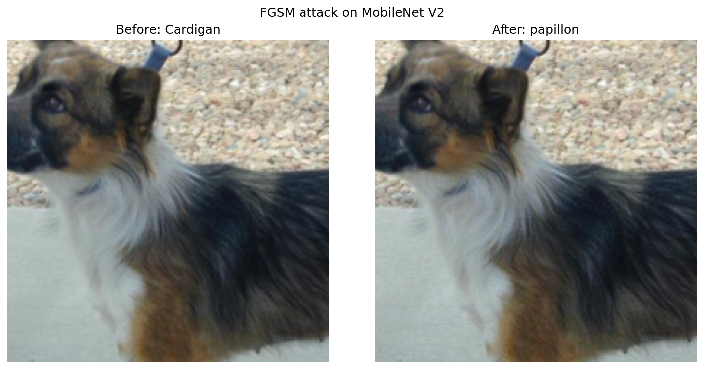
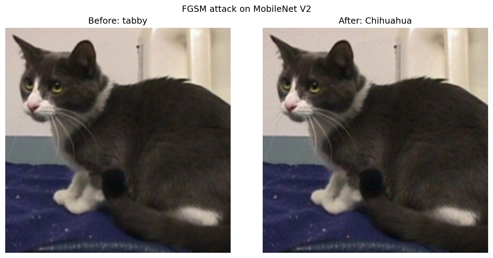

# Pixel Attack on MobileNet V2

Untargeted [FGSM](https://arxiv.org/abs/1412.6572) adversarial attack against a pretrained MobileNet V2 (`IMAGENET1K_V1`).

## Setup

- Model: `torchvision.models.mobilenet_v2`
- Attack: FGSM with `eps = 0.03` in normalized input space
- Goal: flip the top-1 ImageNet class by adding `eps * sign(∇_x L)`

Run:

```bash
python pixel_attack.py <picture file>
```

## Results

| Image     | Clean prediction | Adversarial prediction |
|-----------|------------------|------------------------|
| `dog.jpg` | Cardigan         | papillon               |
| `cat.jpg` | tabby            | Chihuahua              |

Both attacks succeeded: the predicted class changed after a small perturbation.

- **dog.jpg** — Cardigan (Welsh Corgi) → papillon: a flip between related dog breeds.
- **cat.jpg** — tabby → Chihuahua: a larger jump across animal categories (cat → dog), which is expected for untargeted FGSM.

## Plots

### dog.jpg



### cat.jpg


